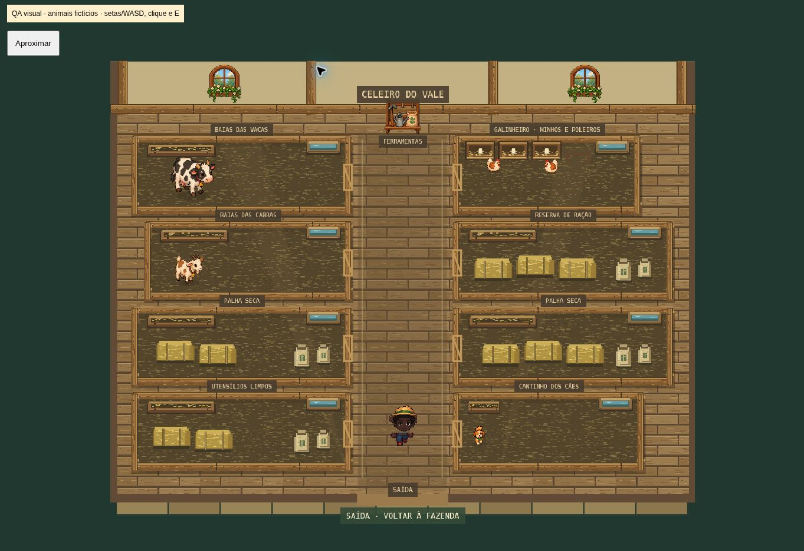

# Ambiente e entradas — 0.7.0

Os recursos já publicados foram incorporados antes desta alteração, incluindo nomes, água, carinho e bem-estar dos animais, ferramentas repetíveis, rega no chão e os atlas originais de cães em `assets/v7`. Nenhum save, conta ou saldo é recriado. Não há alteração de esquema, regras econômicas, autenticação ou banco nesta entrega.

## Implementação

- Cães externos acompanham por rotas até uma posição livre ao lado do dono, evitando construções, galinhas e outros cães. Os quatro quadros de cada direção avançam pela distância efetivamente percorrida; parados, observam e depois deitam. No celeiro, o mesmo atlas percorre um circuito fechado dentro da baia, alternando caminhada e descanso. A proteção das plantações permanece no servidor.
- Piso de tábuas, cercas com grão e relevo, palha irregular, feno amarrado, sacos com dobras, ninhos e cochos usam texturas pixeladas originais criadas uma vez e reutilizadas. Janelas, luz ambiente e suporte de ferramentas com proporção preservada completam o cômodo. Escalas relativas das quatro espécies, corredores, colisões, sobreposição e interações foram preservados. As galinhas externas usam a mesma escala interna.
- Casa, celeiro e venda compartilham a definição de portas. A menos de 85 unidades, aparece Entrar e uma marca no chão; E ou toque confirma. Aproximar sozinho não entra. Clicar na construção calcula a rota e entra ao chegar. Interiores recebem intervalo de 600 ms na transição e ignoram repetição da tecla E. Menus existentes continuam disponíveis.
- Árvores, arbustos e plantações recebem brisa e rajadas; folhas atravessam o cenário e pássaros batem asas com sombras no chão. Os efeitos são externos. Há no máximo quatro pássaros e doze folhas no PC, dois e cinco em viewport móvel. Movimento reduzido desativa esses movimentos e pausa nuvens, partículas e ondulações decorativas.

## Validação e limites

60 testes automatizados e build TypeScript/Vite aprovados. Testes cobrem circuito e quadros do cão, caminho até posição livre, portas/proximidade/bloqueios e uma hora simulada de efeitos com limites de população e movimento reduzido. Testes existentes de preservação de perfil/save, economia e animais continuam passando.

As páginas `tests/barn-preview.html` e `tests/ambience-preview.html` carregam as cenas e componentes reais com dados fictícios, sem contas nem salvamento. Não são uma fazenda online simulada. O navegador confirmou o acabamento do celeiro, alternância de zoom em 390 × 844, cães em movimento e repouso, pássaros e entrada/saída da casa pelo controle compartilhado e chegada ao celeiro sem entrada automática, seguida de entrada pela tecla E. A imagem abaixo é dessa conferência do celeiro.

Não foram usados aparelhos físicos nem medidos FPS ou bateria. Google e operações do banco não foram novamente exercitados nesta etapa; sua configuração e limitações continuam em ONLINE.md. Casinha e patrulha autônoma do cachorro ainda são futuras funcionalidades.
