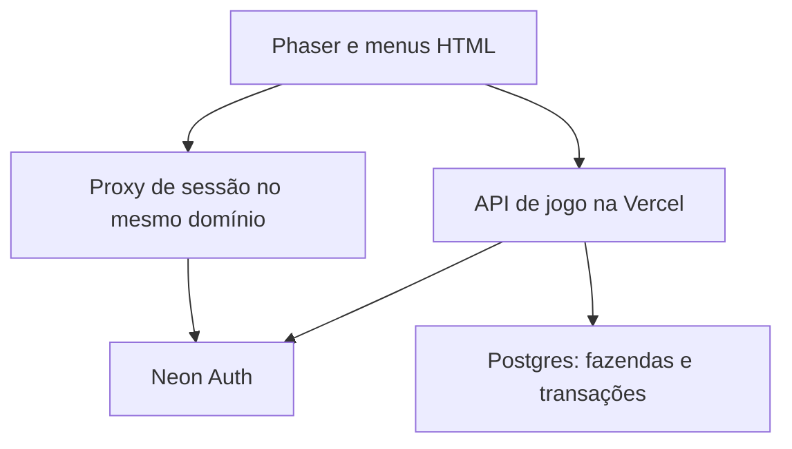

# Arquitetura atual — beta 0.4

Phaser 3.90 renderiza o mundo original em Canvas/WebGL. Menus, foco e formulários usam HTML/CSS. A API Node e a distribuição Vite compartilham o projeto Vercel; o Postgres e a identidade Managed Better Auth ficam no Neon. Referência detalhada: [ONLINE.md](ONLINE.md).

## Dados e autoridade

- `src/farm.ts` mantém o ciclo agrícola puro e o formato local v1.
- `src/online-rules.ts` acrescenta energia, XP, níveis e expansão, sem dependência de Phaser.
- O cliente manda intenções. O servidor define preços, tempo e recompensas e grava a transação. Não aceita uma fazenda inteira enviada pelo navegador.
- `farms.state` guarda o documento da fazenda; `revision` permite detectar conflito entre aparelhos. `action_receipts` garante idempotência por conta e UUID.
- `friendships` guarda pedidos/aceite, `farm_help` limita ajuda diária e `market_listings` mantém produtos reservados até vender/cancelar.
- A API valida JWT assinado pelo provedor e a existência da conta antes de ler ou alterar a fazenda. Visitar ou ajudar exige amizade aceita. E-mail e credenciais não aparecem nos dados sociais.

Transações de economia usam um lock consultivo global nesta beta; antes de maior volume, substituir por locks de linha em ordem estável. Comprador e vendedor mudam na mesma transação. Não há saldo calculado e confiado ao cliente.

## Sincronização e desconexão

Uma fila no cliente preserva a ordem dos comandos; resultados com revisão antiga não substituem os mais recentes. Uma resposta incerta mantém o mesmo UUID para consulta/reenvio. Ao reconectar, confirma-se a intenção anterior antes de aceitar outra. Ganhos offline não são importados. O crescimento usa timestamps absolutos; não precisa manter um timer ou função permanente por planta.

A posição é enviada no máximo a cada 5 segundos de deslocamento e ao ocultar/sair por uma requisição curta com `keepalive`. Se a conexão cair antes da confirmação, o próximo carregamento recupera a última posição salva. O servidor limita deslocamento plausível e exige proximidade nos canteiros; colisões detalhadas continuam no cliente.

O teste local usa `wj-fazendinha-v1` no localStorage, separado da conta. Não se importa saldo local arbitrário para a economia online. O sessionStorage contém somente pedidos de ação pendentes, nunca a senha.

## Mundo e controles

O corpo de colisão fica nos pés; a profundidade acompanha a posição vertical. A navegação A* usa os obstáculos reais da cena com margem para o corpo e proíbe cortar cantos bloqueados. WASD, setas e joystick substituem a rota automática. A ação ocorre perto do alvo, sincronizada ao impacto da animação; itens equipados e mãos pertencem ao mesmo sprite.

A rega usa bico calibrado, gotas e respingos. Galinhas atuais são decorativas. Os sprites são originais, pré-carregados de `public/assets/`; abrir o mapa não depende de geração de imagens. Terreno e efeitos complementares são produzidos em canvas.

## Instalação e publicação

O build produz uma PWA com cache versionado de arte, JS, CSS e shell HTML. API e identidade não entram no cache. A conta exige rede, enquanto o teste local pode abrir offline após o primeiro carregamento. O aplicativo é instalado pelo navegador; não é ainda um pacote de loja.

Segredos ficam nas variáveis de ambiente do servidor. `VITE_NEON_AUTH_URL` é um endereço público e serve de configuração de disponibilidade; o navegador usa o proxy no mesmo domínio para evitar depender de cookies de terceiros. Banco de produção não deve ser colocado automaticamente em previews. Migrações são explícitas, e credenciais, códigos de recuperação e sessões de teste não são versionados.
