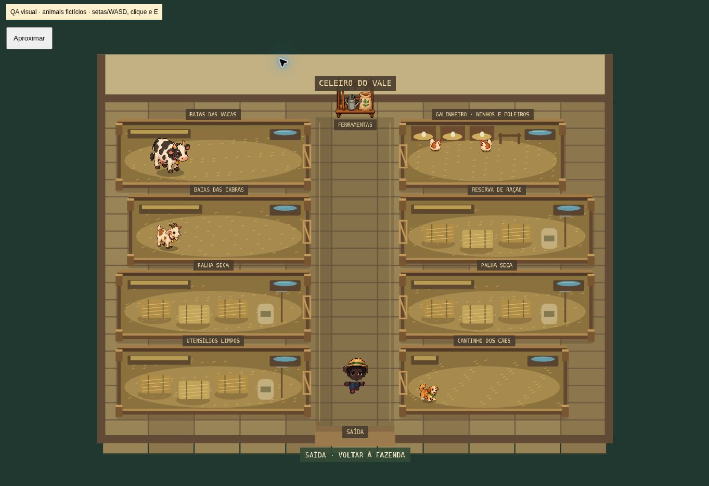

# Chegada ao vale e celeiro — 0.6.0

## Primeira entrada

Nome → escolha visual de personagem → conta Google → fazenda. Há seis combinações dos avatares originais já existentes: meninas e meninos com diferentes tons de pele, incluindo Lia e Caio negros. Pele, cabelo, roupa e estilo continuam editáveis nessa etapa. A seleção tem retrato e indicação visual de ativo.

O nome é validado no navegador e no servidor: 1 a 24 letras/números, com espaços, ponto, hífen e apóstrofo permitidos; nomes vazios e controles são recusados. O rascunho de nome/avatar/etapa fica em `wj-profile-draft-v1` antes de abrir o provedor. Não contém senha nem token. Falha ou cancelamento não apaga as escolhas. A opção de e-mail/senha permanece como alternativa explícita.

Na volta da autenticação, a conta é carregada primeiro. Contas novas são criadas com `profileComplete:false`; o comando transacional `initialize-profile` grava nome, avatar e conclusão uma única vez, sem recriar inventários ou moedas. O nome também atualiza a identificação pública da fazenda. Contas antigas, inclusive saves sem o campo novo, são consideradas existentes e não recebem o rascunho de cadastro. Clientes antigos que ainda executem ações válidas antes de ver o novo fluxo também tornam a fazenda existente. UUID/revisão protegem a finalização como as demais ações.

Nas entradas seguintes, uma sessão reconhecida carrega a fazenda. Se a sessão expirar, a tela oferece reconexão, mantendo o rascunho quando houver. O teste local anterior permanece separado e preservado. Não houve migração destrutiva de dados nem nova tabela.

Google continua usando a autenticação gerenciada Neon e o provedor compartilhado já habilitado. Para a marca WJ aparecer na autorização, faltam Client ID/Secret Google próprios. A autorização pessoal Google depende do jogador. Não há acesso à caixa do Gmail.

## Celeiro

O mesmo InteriorScene real é usado no jogo e nos testes visuais. O layout distribui até 12 animais em oito áreas por espécie: vacas (até duas por baia), cabras (três), galinhas (seis) e cães (quatro). As combinações são testadas para não perder animais na distribuição. As baias de vacas são mais largas (335 pixels) que os recintos de cabras (315), galinhas (285) e cães (290), mantendo os portões alinhados ao corredor. Áreas sem animais recebem feno, palha, ração e utensílios em vez de placas grandes de vazio.

Tamanhos máximos de exibição em pixels do mundo: vaca 68×62, cabra 44×47, cachorro 34×32, galinha 21×23. O personagem mantém cerca de 69 pixels de altura. Cercas, portões fechados, comedouros, água, palha, ninhos e poleiros são desenhados no estilo do ambiente, usando os sprites originais dos animais e equipamentos.

No celular, o celeiro abre com visão geral e oferece Aproximar / Ver cômodo inteiro; o modo aproximado acompanha o personagem. O corredor central é caminhável. A baia inteira é um obstáculo físico e também entra na busca A*: o personagem interage pelo portão, sem atravessar os animais. Cada animal permanece em uma célula interna e não atravessa cercas ou outro animal. Caminhadas curtas, respiração, pequenas inclinações de alimentação e texturas de piscada dão movimento sem alterar relógios de produção. As cercas da frente sobrepõem os animais; placas ficam acima. Novas compras reorganizam o interior ao fechar os painéis.

Alimentação, coleta e proteção do cachorro continuam usando as regras e comandos reais existentes. Nenhum animal ou produto visual foi acrescentado ao inventário dos jogadores.

## Validação

54 testes automatizados aprovados: compatibilidade e economia anteriores, gravação única do perfil, rejeição de substituição de perfil existente, validação/recuperação do rascunho, todas as distribuições de 12 animais, limites das animações, escala relativa da galinha e rotas até todos os portões. Build TypeScript/Vite/PWA aprovado.

Na prévia local foram conferidos nome vazio, escolha do menino negro Caio, avanço à conta e restauração após recarregar. O celeiro foi inspecionado usando uma fazenda fictícia com as quatro espécies, sem alterar contas reais: `tests/barn-preview.html`. Interação por E no corredor abriu o painel de cuidados de teste. `tests/barn-mobile.html` e `tests/mobile-preview.html` permitem conferência em 390×844.

O teste HTTP publicado com conta sintética confirmou nome/avatar gravados uma vez, replay idempotente, recarga com moedas e sementes preservadas e recusa de substituição do perfil. O OAuth iniciou e redirecionou para accounts.google.com. A galeria também foi conferida no endereço de produção. O consentimento Google e a entrada final pelo navegador com uma conta pessoal não foram executados. Uma conferência em viewport móvel não substitui teste em Android/iPhone físicos. Não declarar autorização Google pessoal como concluída apenas por validar o redirecionamento.

Celeiro renderizado pelo código real com animais de teste:

A segunda rodada HTTP aguardou a produção real da galinha e confirmou alimentação, consumo de uma ração, coleta de um ovo, replay sem duplicação e rejeição de nova coleta antecipada. Não foram alterados relógios nem saldos por SQL. A visão geral e o modo aproximado também foram alternados no iframe móvel.
