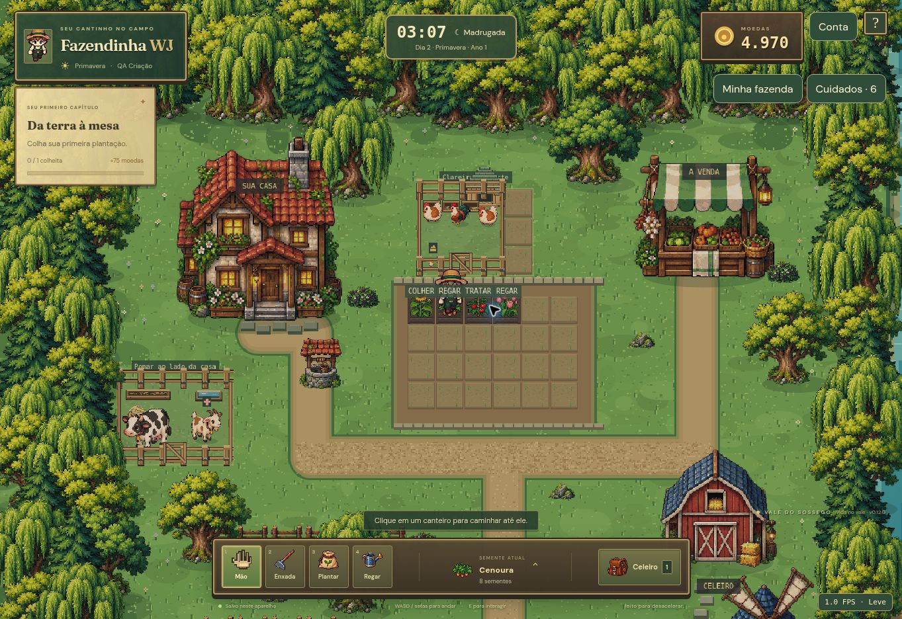

# Criação e cuidados — 0.12.0

Esta entrega usa os animais, personagens e a arte original já existentes. Os passos de vacas, cabras e aves agora usam quatro quadros próprios gerados e guardados em cache, com trajetórias contínuas, aceleração/desaceleração e pausas reais. Cães passaram a contornar curvas em vez de virar bruscamente nos cantos. Os animais ficam em células de circulação dentro de seus espaços; o personagem não atravessa cercas.

## Necessidades e saúde

Alimentação e água caem progressivamente durante 24 horas reais. Podem ser repostas quando chegam a 70% ou menos. A limpeza dura 48 horas; trocar a cama consome uma palha. Carência prolongada de ração/água (36 horas) ou sujeira (72 horas) causa doença. Abastecer não cura automaticamente uma doença instalada. O jogador precisa resolver ração, água e higiene e depois gastar uma dose de remédio veterinário. A produção futura pausa sem essas condições; um produto já produzido não desaparece ao faltar cuidado. Não há morte ou remoção automática de animais nesta beta.

A aba Cuidados da venda oferece remédio veterinário (3 doses / 30 moedas), defensivo orgânico (3 doses / 18 moedas) e palha limpa (5 porções / 10 moedas), com quantidade validada no servidor. Na primeira ativação há um pequeno estoque de apoio: 1 remédio, 2 defensivos e 3 palhas. Preços e consumo não aceitam valores enviados pelo cliente.

## Plantas

A terra permanece úmida por 10 minutos reais; sem umidade o crescimento e a colheita ficam bloqueados. Trinta minutos sem água ou 45 minutos com pragas podem causar doença. Regar preserva o crescimento acumulado e não cura doença; depois da rega é preciso um defensivo. Pragas simples continuam sendo removidas com a mão e podem voltar depois de 20 minutos. Plantas não somem durante a ausência. O painel Cuidados mostra a situação de cada canteiro e permite ir regar, remover pragas e aplicar tratamento.

## Instalações e reprodução

A venda oferece galinheiro externo (220 moedas, 3×3 espaços, até 6 aves) e piquete (300 moedas, 4×3 espaços, até 2 vacas/cabras) nos terrenos adicionais comprados. O celeiro mantém 12 vagas. Ovos em choco contam na capacidade. A transferência preserva o mesmo ID, nome, necessidades e produção, sem criar cópias. A compra permite escolher uma instalação compatível. Os quatro frangos decorativos que existiam soltos foram retirados; os animais dos cercados externos pertencem ao jogador.

O ovo aparece fisicamente no ninho quando há produção pronta. Clique nele para caminhar até a instalação e coletar, ou use o painel de cuidados. Uma galinha e um galo saudáveis, alimentados e com água na mesma instalação podem iniciar um choco com um ovo do estoque ou pronto no ninho. A reserva leva dois minutos reais e a eclosão automática aguarda a saúde da mãe. O filhote nasce no mesmo local. Com ração, água, saúde e cinco minutos reais, cresce; parte dos nascimentos resulta em galo. O crescimento mantém o ID do pintinho.

O calendário visual e dormir não pulam nenhum prazo de cuidados, produção ou nascimento. Os relógios usam tempo real e, no online, referência do servidor. A geração atual mantém um produto pendente por animal, sem produção offline ilimitada. A doença é consequência da negligência, não uma rolagem aleatória invisível.

## Compatibilidade e verificação

A versão 5 do protocolo ativa os cuidados apenas ao abrir com o cliente novo. A migração adiciona um início de cuidados com carência, conserva saldos/identidade/cultivos e registra produtos antigos já prontos. Clientes anteriores não podem modificar uma fazenda depois de ativada, prevenindo perda dos novos campos. O armazenamento continua sendo o JSON existente, sem apagar ou substituir a fazenda.

93 testes automatizados e compilação aprovados nesta etapa: migração, fome/sede/doença/recuperação, consumo único, produção preservada, rega sem reinício, defensivo, capacidades, choco, nascimento e crescimento, espécies válidas por instalação, transferências, salvamento e limites das trajetórias. A conferência visual usa um cenário local fictício com algumas idades preparadas para observar situações de cuidado e eclosão. Isso não representa um teste com relógio alterado no serviço online. O teste online natural está em `scripts/smoke-husbandry.mjs`, que cria uma única conta sintética, espera os prazos reais e ganha as moedas por agricultura normal; passou em produção em 28/10/2026, no commit `167ed52c98368c8dbadc029ddb02b1952c63c9f1`: produção real → ovo → choco → pintinho → adulto, sem alterar relógio, gravar diretamente no banco ou salvar credenciais em arquivo. Validou ainda preço fixo, recibos/replay, recusa de coletas duplicadas e crescimento antecipado, cliente legado, renda agrícola normal, compra de terreno/galinheiro, transferências por ID e restauração do progresso.

Na interface real, com o cenário fictício, foram confirmados: rega seguida de tratamento do girassol (defensivo 6→5), ração/água/limpeza/remédio da vaca (todos os indicadores voltaram a 100%), transferência celeiro→piquete sem duplicação e compra de remédio com venda permanecendo aberta. Em viewport 390×844, o painel de cuidados, categorias e compra foram operados; após recarregar, saldo e tratamentos permaneceram. Não houve teste em celular físico nem nova promessa de 60 FPS.

Limites desta etapa: reprodução apenas de aves; cuidados usam tempo real e podem pausar produção, sem morte automática. Não há gestação de vacas/cabras, genética ou veterinário presencial. A imagem acima usa dados fictícios para exibir situações, separadamente da validação online natural.
