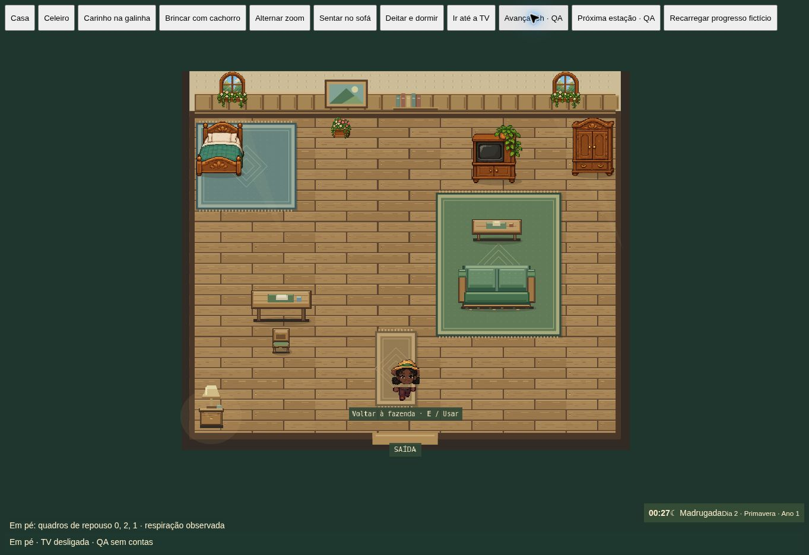

# Iluminação, respiração e desempenho — 0.11.0

A noite passa de até 48% de escurecimento para 16% na fazenda e até 5,6% nos interiores. Bordas e sombras de nuvens também ficaram mais leves. O calendário e a economia não mudam.

A respiração passa a usar três quadros de pixel art em um ciclo de três segundos. Cabeça, ombros, mãos e equipamento sobem juntos por até dois pixels; pernas e pés ficam idênticos. Os atlas são gerados uma vez por avatar/ferramenta e reutilizados. Isso evita depender de diferenças fracionárias de escala que podem desaparecer com arredondamento de pixels. Funciona em pé, no sofá e sob a coberta. A respiração fica ligada por padrão e tem opção própria para desligar no painel de desempenho. A preferência de movimento reduzido do sistema continua sendo respeitada nos pássaros, vento e partículas.

O motor usa requestAnimationFrame com meta de 60 FPS e preferência de GPU de alto desempenho. Não há limitador rígido que descarte quadros por arredondamento de tempo. O botão de FPS mostra a taxa realmente renderizada, nunca a meta configurada. O painel mostra intervalo p95 entre quadros e CPU p95 do ciclo JavaScript; a medida de CPU não inclui toda a execução assíncrona da GPU.

O modo automático muda para efeitos leves após duas janelas de dois segundos abaixo de 50 FPS e volta ao completo após cinco janelas acima de 57 FPS. Também há escolha manual. Em modo leve, partículas, sombras de nuvens e ondulações decorativas pausam; vento e aves permanecem em menor quantidade. Movimento, ferramentas, produção e regras da fazenda continuam ativos. As escolhas visuais ficam numa chave local separada do save.

Otimizações realizadas: piso, tapetes e luzes fixas dos interiores reunidos em uma camada de GPU por entrada; cache de obstáculos dos cães invalidado quando construções mudam; no máximo um planejamento de cão a cada 150 ms; nenhum mapa de obstáculos quando não há cão; portões redesenhados apenas ao mudar de estado; indicadores e rótulos atualizados em frequência menor; efeitos vazios não alocam listas por quadro; vento fora da câmera deixa de atualizar árvores; comparação de avatar sem serialização JSON por quadro. A atualização do PWA busca a página atual na rede, mantém fallback offline e duas gerações anteriores de assets para abas abertas. Nenhum dado de conta ou API entra no cache.

## Verificação

85 testes e build aprovados. Os novos testes verificam pixels dos pés e mãos, FPS calculado a partir dos quadros reais, travamentos, adaptação com histerese e atualização/offline do PWA. Um teste antigo foi estabilizado: fazendas recém-criadas têm início de calendário em Date.now(), portanto comparações com outra criação em milissegundo diferente não são equivalentes; agora o teste valida a janela de criação e compara todos os outros dados.

Na cena real de QA, os quadros 0, 1 e 2 foram observados alternando, e casa e celeiro foram inspecionados na madrugada após gerar o cache dos pisos. O jogo principal abriu com um save local fictício, preservando nome e 250 moedas; também foi inspecionado em 390×844. Fixtures de QA não são incluídos no build de produção.

O ambiente remoto mediu cerca de 1,0 FPS tanto na fazenda quanto no controle vazio de requestAnimationFrame (sem Phaser). Na fazenda, o intervalo p95 foi 1018,9 ms e CPU p95 2,1 ms. Isso indica limitação no agendamento de quadros deste ambiente; não comprova 60 FPS em hardware real e não permite estimar ganho percentual. Não foi usado celular físico nem concluído benchmark sustentado de 60 FPS. A próxima validação deve usar o contador do jogo em PC e aparelhos de referência, durante caminhada, rega e celeiro cheio, por pelo menos 60 segundos.

