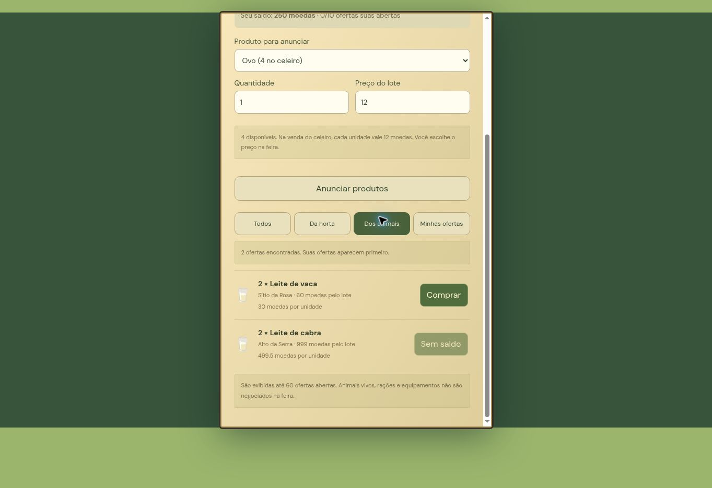

# Feira 0.5.1 — publicada

Ovos, leite de vaca e leite de cabra usam a mesma reserva transacional das culturas. O campo de protocolo `crop` foi mantido para preservar ofertas e recibos anteriores, mas agora pode identificar qualquer um dos dez produtos. Estoques agrícolas continuam em `inventory`; produtos animais continuam em `products`. Anunciar retira o estoque disponível, cancelar devolve, comprar transfere o produto reservado e o preço do lote. Vender no celeiro não vende a reserva da feira.

Filtros: Todos, Da horta, Dos animais e Minhas ofertas. A tela mostra saldo, quantidade disponível, limite de ofertas, preço do lote e valor por unidade. Produtos sem estoque não podem ser selecionados; ofertas acima do saldo não podem ser compradas pela interface. O servidor revalida todas as ações. Filtros e rolagem são mantidos após compras e cancelamentos. Até 60 ofertas são carregadas, priorizando as próprias.

`?community=1&marketVersion=2` recebe o catálogo completo. Clientes antigos sem essa opção recebem somente cenoura, alface e tomate, reconhecidos desde a primeira beta online, evitando falha ao exibir novos produtos.

## Migração aplicada

`migrations/003-animal-market.sql` amplia o CHECK da coluna `crop` em `market_listings`: acrescenta `egg`, `milk` e `goatMilk`. Não contém remoção de tabelas, linhas, moedas ou inventários. A troca da restrição é feita em um único ALTER TABLE; o Postgres valida as linhas e pode bloquear brevemente acessos à tabela durante a alteração. A consulta de pré-validação encontrou quatro ofertas existentes e zero incompatíveis com a restrição nova.

Após autorização do usuário para publicar, a migração 003 foi aplicada com sucesso. A restrição foi relida no banco e contém os dez produtos. A versão 0.5.1 foi promovida para produção na Vercel.

Ordem executada para a publicação:

1. Aplicar a migração 003 no banco `neondb` do projeto atual, preservando os dados.
2. Publicar o código e conferir a versão 0.5.1.
3. Rodar `NODE_USE_ENV_PROXY=1 node scripts/smoke-market.mjs https://fazendinha-wj.vercel.app` com contas sintéticas novas. O script aguarda a produção real de um ovo e verifica reserva, replay, compra concorrente, crédito/débito, cancelamento único e venda posterior.

## Validação concluída

- 47 testes automatizados passaram. Os dez produtos passam por reserva, transferência, venda e conservação de moedas; também são verificadas entradas malformadas, quantidades/preços inválidos, insuficiência de estoque/saldo e devolução ao cancelar.
- Build TypeScript/Vite/PWA aprovado, incluindo módulos de API.
- Prévia de navegador `tests/market-preview.html` usa o mesmo renderer e as mesmas regras com fazendas fictícias, sem banco. Confirmados: reserva de dois ovos (estoque 4 → 2), cancelamento (2 → 4), filtro de ofertas próprias, compra de dois leites por 60 moedas (saldo 250 → 190, estoque 2 → 4) e bloqueio de compra acima do saldo.
- Layout e compra também conferidos no iframe de 390 × 844 de `tests/market-mobile.html`; os filtros se organizam em duas colunas. É teste de viewport, não de aparelho físico.
- Testes em aparelhos físicos continuam pendentes. A prévia com fazendas fictícias não comprova persistência online; o teste HTTP publicado é registrado abaixo separadamente.

Captura da prévia local com dados fictícios:

## Teste online após a publicação

`scripts/smoke-market.mjs` concluído com sucesso no endereço público, com duas contas sintéticas e produção real de um ovo. Confirmados: reserva ao anunciar, repetição idempotente do recibo, exclusão de produtos desconhecidos na resposta para clientes antigos, duas compras concorrentes com um único sucesso, transferência única de ovo e moedas, cancelamento com devolução única, replay do cancelamento sem duplicação e venda no celeiro do produto comprado. O script não gravou credenciais em disco.

O endereço principal respondeu HTTP 200 com a versão 0.5.1. A Vercel confirmou o deployment de produção como READY. Para atualizar uma instalação que ainda mantém a versão anterior no cache, fechar todas as abas do jogo e abrir novamente.
