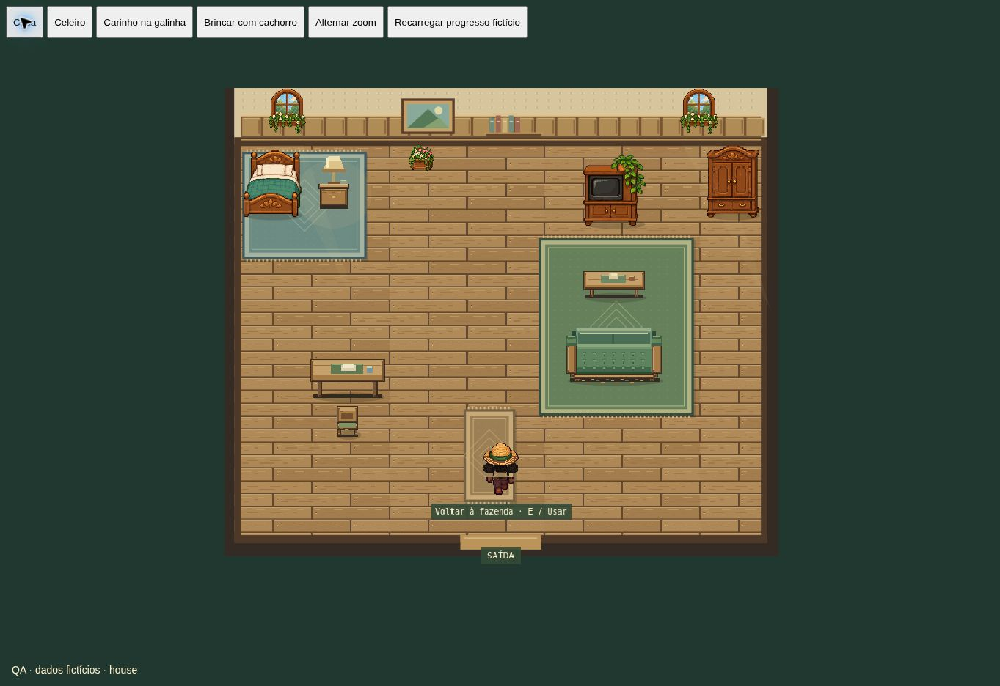
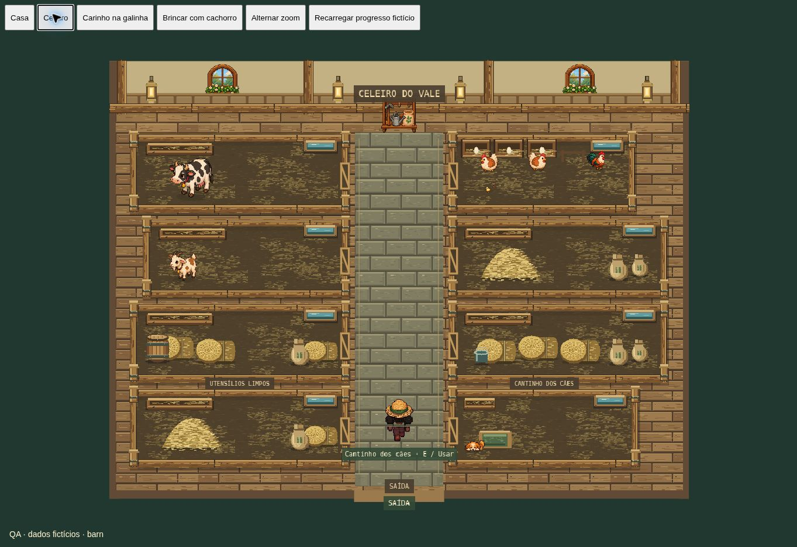

# Casa e celeiro — 0.9.2

A cama fica no canto superior esquerdo, com a cabeceira junto à parede e mesa lateral com abajur. O armário ocupa o canto superior direito. A TV e o sofá compartilham o mesmo eixo, com mesa de centro entre eles. O sofá usa um desenho original de costas, voltado para o norte, de modo que quem se senta olhe para a TV. Não foi invertida a imagem frontal do sofá. Mesa de refeições e cadeira ficam na outra lateral, preservando a passagem central até a saída.

A casa recebe papel de parede discreto, madeira com veios, tapetes tecidos com franjas e motivos geométricos, molduras e iluminação suave. Cama, TV e armário reaproveitam as imagens detalhadas existentes. Os móveis novos são texturas pixeladas originais criadas uma única vez em canvas.

O celeiro mantém suas baias e ganha um corredor central de pedra, lanternas, postes com ferragens e objetos com silhuetas mais naturais: fardos redondos com fibras enroladas, pilhas de palha arredondadas, sacos abaulados, barris com aros e ninhos com ovos arredondados. Os limites, animais, animações, portões e cuidados permanecem os mesmos.

79 testes e build aprovados. Os testes de navegação usam os mesmos obstáculos do cômodo e verificam acesso a todos os móveis e saída; também conferem a cama junto às paredes, o armário no canto e o alinhamento/orientação do sofá e da TV. A alteração se limita à apresentação e aos obstáculos da casa. Contas, saves, moedas, terrenos, produção e respiração não sofrem migração ou reinicialização. A prévia de QA usa dados fictícios nas cenas reais, sem autenticação. Testes em aparelhos físicos continuam pendentes.

Conferência visual no navegador com as cenas reais e dados fictícios:

