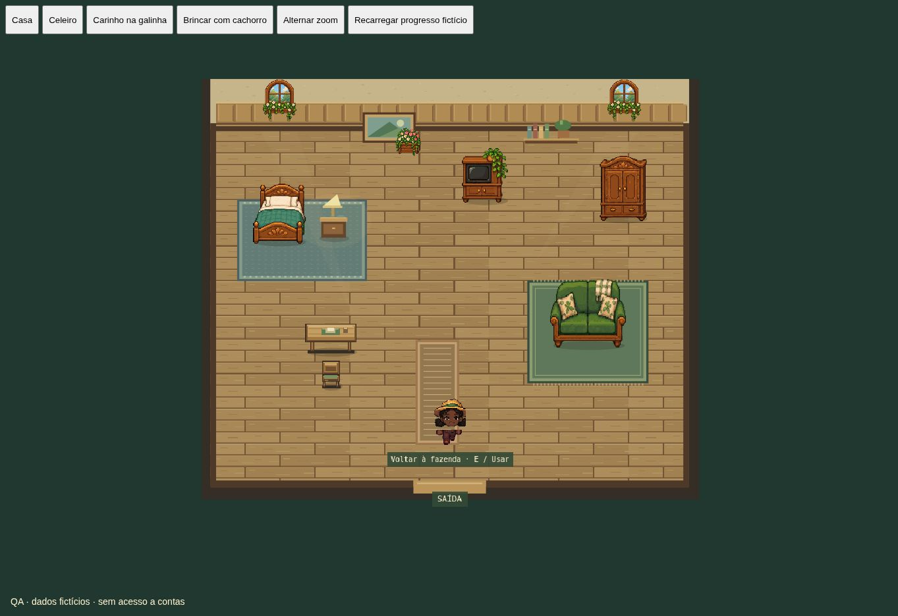

# Interiores, cães e terrenos — 0.9.0

Esta versão incorpora todos os avanços publicados até a 0.8 antes de alterar o projeto. Preserva nomes, avatar, cuidados, galo/pintinhos, incubação, economia e os saves anteriores. Não há migração de banco: os campos adicionais ficam no estado JSON já transacionado pelo servidor.

## Visual

Quarto e sala reutilizam as imagens detalhadas originais de cama, sofá, TV e guarda-roupa; acrescentam tapete no quarto, corredor de tecido, mesa de cabeceira, abajur, quadro, prateleira e revestimento de madeira na parede. Os móveis mantêm colisões e pontos de interação alcançáveis. O celeiro recebe detalhes de parede, luz discreta, pilhas de palha, barris e baldes, preservando baias, cuidados animados e produção. Galinhas passam de 21×23 para 27×29 unidades; continuam menores que as vacas (68×62). Galo e pintinho acompanham a escala.

O atlas do cão tinha pixels semitransparentes. O preparo em canvas conserva a principal silhueta de cada quadro, elimina pixels isolados e torna seu contorno opaco. Um corpo físico invisível conserva suas dimensões enquanto uma única imagem desenha a animação em coordenadas arredondadas. Não há cópias, rastros ou efeitos de fade no cão. O mesmo atlas corrigido atende o celeiro e o exterior.

## Terrenos e obras

Na venda há uma categoria própria, com mapa de seleção e confirmação do preço. Existem três áreas seguras: ao lado da casa, na clareira do norte e ao sul do celeiro. Cada uma custa 750 moedas e oferece 12 espaços; contas online precisam primeiro liberar os 24 canteiros iniciais. É possível comprar todas as três áreas. O primeiro terreno antigo continua à esquerda da casa, com os mesmos IDs e tempos de cultivo.

Em cada área é possível colocar um abrigo de ferramentas (250 moedas, acesso aos equipamentos por clique) ou um coreto de jardim (180 moedas, decoração com interação). Cada construção ocupa 2×2 espaços escolhidos na grade. O restante continua plantável. Há uma construção por terreno, para preservar acesso. O servidor recusa sobreposição, posição fora da grade, terreno de outro local, saldo insuficiente e construção sobre plantas. Preços vêm das regras do servidor; requisições repetidas usam os recibos existentes e não debitam duas vezes. Não há demolição ou realocação nesta entrega.

Os novos IDs são atribuídos pela ordem de compra. A posição de cada canteiro é calculada a partir do terreno salvo tanto no cliente como na verificação de proximidade do servidor. Construções têm colisão real e rotas contornam sua base. Elementos decorativos aleatórios deixam livres as três áreas. Saves locais guardam os canteiros extras separadamente, mantendo o núcleo antigo. Clientes antigos são impedidos de alterar fazendas com as novas posições ou construções, para não sobrescrever o progresso.

## Verificação

79 testes automatizados e build TypeScript/Vite aprovados. Incluem preservação de plantações antigas, compra na ordem norte/oeste/sul, recarga de todos os canteiros, bloqueios de construção, preços e energia online, contorno dos edifícios e limpeza do atlas do cão. As páginas de QA carregam os componentes reais com saldo e animais fictícios, sem acesso a contas pessoais. Navegador: quarto, celeiro, seleção de terreno, compra, escolha da posição, construção e recarga preservando saldo.

`scripts/smoke-land.mjs` valida o serviço publicado com uma conta sintética e moedas/nível obtidos pela agricultura normal, sem alterações diretas no banco. O resultado da execução deve ser registrado em VALIDACAO.md após a publicação. Não foram usados aparelhos físicos; desempenho, bateria e multitouch real continuam pendentes.

