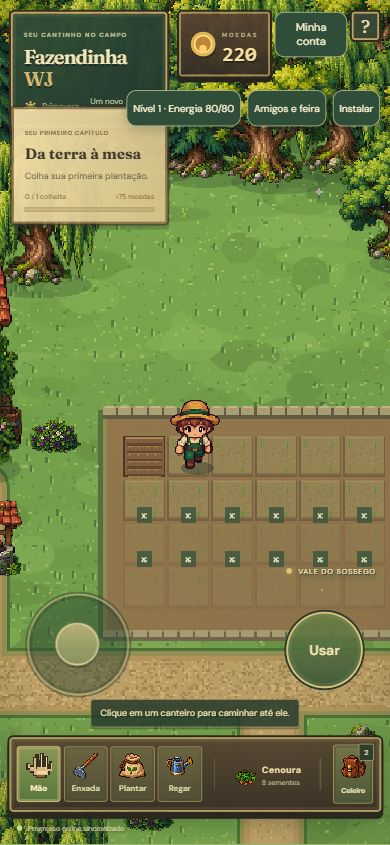
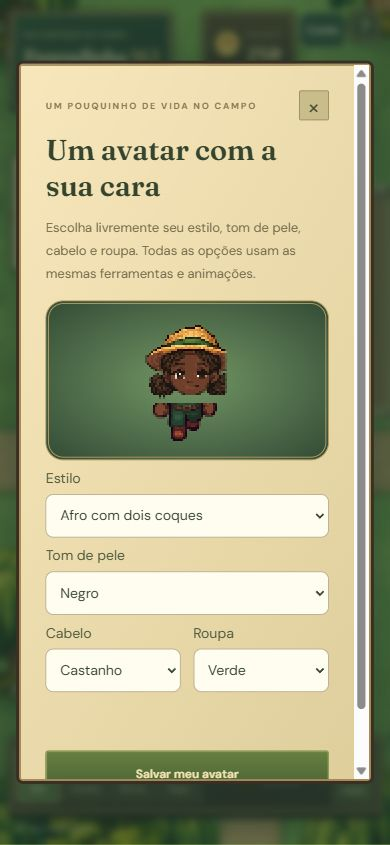
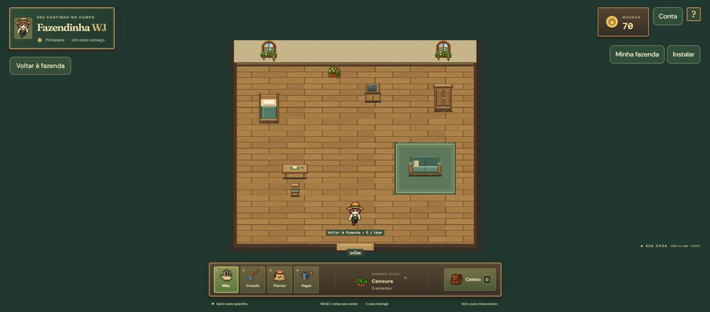

## 0.45 — visitas, produtos e cinco roubos por hora

Cota móvel por visitante/fazenda, mensagens reais do servidor, produtos com estoque do visitante e comportamentos compartilhados entre criações. Botões compactos de chamada e atalho R$ à direita. Migração 019 aditiva, sem converter estados antigos. 346 testes/build aprovados; sandbox PC/celular e API confirmaram produtos do visitante, loja sem cobrança, cinco roubos, sexto bloqueado, mensagens distintas, cota e persistência. Cenários criados/sul e expiração da hora cobertos no motor/banco isolado. Publicação de produção em andamento; veja VISITAS_045.md.

## 0.44 — defensivo, cuidados mais espaçados, roubo consentido e desempenho

Corrigida recaída imediata por estresse climático antigo. Cadência animal mais longa para espécies originais e criadas. Consentimento de roubo prevalece sobre cachorro; pausa e limites preservados. Luzes/chuva/rotas otimizadas. 338 testes e build; perfil local com 20 animais e chuva. Detalhes e limites em CUIDADOS_044.md. Validação autenticada no sandbox publicado confirmou em 1280/390px: tratar planta com estresse 100%, colher pela mão e reabrir mantendo 3 produtos e apenas uma dose consumida. Testes HTTP com duas contas QA confirmaram cachorro saudável + consentimento, bloqueio se qualquer participante desativa, entrega de 1 produto uma única vez com replay do recibo, pausa de uma hora e mensagem com minutos restantes, sem mudar moedas. Não houve cobranças reais. Publicação de produção em andamento.

## 0.43 — lucros de cultivo e produção animal

Quantidade e duração salvas por plantio, intervalo animal versionado após a primeira coleta, preços unitários e estoques preservados. 328 testes e build passaram. Prévia isolada do jogo em 1280/390px validou compra/indicadores, venda numérica e por item, ciclo completo e persistência, sem erro JS ou transbordamento. Publicação em andamento. Consulte LUCROS.md.

## Runtime administrativo — em validação no sandbox

Implementados catálogo consumido pelo jogo, animais novos separados dos registros antigos, prévia isolada, editor de terrenos, cenários com cultivo/colisão/portas/pesca, compras por transação existente, cosméticos/modelos no renderizador original, biblioteca PNG/WAV versionada, concessões idempotentes e configurações por público. 288 testes passaram. Validação autenticada e visual publicada em andamento; não declarar os exemplos completos concluídos antes dela. Nenhuma mudança aplicada ao banco de produção nesta etapa.
Conferência pública 0.35.0: jogo carregou em 1280/390px, pagamentos prontos e APIs protegidas. Ajustada mensagem de sessão ausente do painel para português após o SDK retornar Unauthorized. Nenhum dado ou controle administrativo exposto sem sessão.

## Central administrativa — base em desenvolvimento

Branch codex/admin-creation-studio: autenticação exclusiva no servidor, definições versionadas, grupos/públicos estáveis, consulta de contas/pedidos e coleta de atividade. 278 testes passaram e build passou. Migração aditiva 014 testada no banco isolado. Executor de conteúdo, editor visual, arquivos, concessões, edição estrutural do progresso e configuração efetiva do jogo ainda pendentes; não considerar o pedido completo. Consulte docs/ADMIN_GUIA.md. Sandbox autenticado confirmou autorização 401/403, recibos idempotentes, rascunhos persistentes, público self/grupos, suspensão, restauração sem alterar bens e consulta de pedidos/atividade. Interface 1280/390px: salvar/reabrir/buscar e acesso negado para conta comum, sem erro JS nem transbordamento. Sandbox confirmou ajuste exato uma vez, bloqueio por revisão antiga, recuperação preservando o restante da fazenda e recusa de recuperação sobre valor posterior. Nenhuma cobrança ou reembolso criado.
## 0.31.0 — passeios felizes, cuidados nas visitas e seleção na baia

Iniciar passeio completa a felicidade e ela permanece cheia enquanto o passeio estiver ativo. Baia com vários animais abre uma lista numerada com nomes, espécies e condição; funciona no portão e ao escolher animais, inclusive gatos/cães, na fazenda própria e no celeiro visitado.

Visitantes autorizados podem alimentar, dar água, limpar, medicar, brincar, acariciar, oferecer peixe ao gato e iniciar/encerrar passeio. Recursos saem do visitante, informado no painel. Passeio mantém proprietário, baia, instalação e configuração original; concessão temporária de 45s renovada a cada 8s de visita ativa. Sair tenta devolver imediatamente; queda de conexão/aba suspensa deixa expirar e retorna ao local original. Outro visitante não pode tomar o passeio; dono pode revogar cuidados ou retomar o controle.

242 testes e build aprovados. Navegador 1280/390px: seleção dos 5 animais por teclado/toque, felicidade cheia, cuidados completos no celeiro com estoque do visitante, acompanhamento real/brincadeira na fazenda e devolução sem mudar proprietário/baia. Regressão da assinatura estável do celeiro impede reiniciar a cena por renovação do passeio. Roteiro scripts/qa-friend-care031.mjs; sandbox autenticado validou permissões, estoque do visitante, felicidade completa, renovação, passeio/brincadeira fora do celeiro, devolução, revogação e retomada pelo dono. Interface publicada de testes confirmou portão, seleção entre 5 e passeio salvo. Resposta pública normaliza passeios expirados no relógio do servidor. Nenhuma migração de tabela nem teste destrutivo em produção.

Também verificado: produto pronto no curral externo abre cuidados para o visitante, sem permitir coleta; passeio expirado omitido da resposta pública após correção no sandbox (antes vinha marcado, depois voltou à baia). O dono controla a opção Permitir cuidados e passeios por amigos.

## 0.30.0 — oito baias e cuidados equilibrados

Cada baia suporta cinco animais de qualquer espécie; total de 40 vagas no celeiro. Compra e transferência permitem escolher a baia, com contagem individual e validação no servidor. Ovos em incubação reservam vaga na baia da mãe. Redistribuição aditiva dos animais antigos sem baia; IDs, saldos, nomes, produção, cuidados e configurações de acompanhamento são preservados. Protocolo 14 impede que clientes antigos sobrescrevam a nova distribuição.

Todos os animais recebem texto FOME, SEDE, DOENTE, LIMPEZA ou DESCANSO quando aplicável. Doença tem prioridade; necessidades simultâneas alternam o aviso. Cuidados completos duram aproximadamente 90min para comida, 75min para água, 120min para limpeza, 90min de energia de passeio/felicidade, com variações por espécie. Avisos abaixo de 30%. Novos animais começam com 70% de reserva; os estados já salvos não são preenchidos nem apagados. Offline limitado a 2min por retorno. Não há punição extra por sono.

235 testes e build aprovados. Navegador 1280/390px: escolha na compra e transferência de cachorro, 40 animais misturados desenhados nas baias, recusa de sexto sem débito, avisos, carinho no cachorro e peixe ao gato com portões abertos e retorno, recuperação após recarregar. Script: scripts/qa-barn-pens030.mjs. Sandbox 36a9ece validado: distribuição aditiva de 12 animais antigos preservou IDs, nomes, saldo, produto pendente e doença; compra na baia selecionada, transferência, disputa da última vaga com um único débito, recusa por baia inválida/cheia, 40 animais após novo login e bloqueio do cliente antigo.

## 0.29.4 — compra de cachorro e confirmação

Vídeo recebido mostra celeiro cheio e saldo inalterado de 3.617 moedas; a capacidade continua 12 incluindo incubação. Vagas e impedimento agora ficam junto à compra. Confirmação Compra feita! por toast e no cartão somente após retorno bem-sucedido. Layout dos animais legível no celular. Nova compra de cachorro respeita destino Celeiro, sem alterar cães existentes (configuração anterior preservada).

Corrigido clique descartado após recuperar posição pendente; recibo recuperado da mesma compra confirma a entrega existente sem repetir débito. Outra ação pendente exige conferência explícita. 229 testes e build aprovados. Navegador em 1280/390px: lotação sem débito, vaga disponível, clique duplo com entrega única, mensagem, cachorro renderizado no celeiro e compra mantida ao recarregar. Regressões em tests/dog-purchase.test.ts e scripts/qa-dog-purchase-0294.mjs.

## 0.29.3 — entrada por comando, sem círculos

Aproximar-se das portas mostra Entrar; é necessário apertar o botão ou E para abrir casa, celeiro e venda. Chegar por caminhada ou por destino clicado não abre automaticamente. Mantida a ausência de círculos. Celeiro visitado usa o mesmo botão/ação próxima. 225 testes e build aprovados. Teclado (1280px) e joystick/botão (390px) testados nas três portas, aguardando antes de entrar e após sair/fechar a venda. Regressão em scripts/qa-manual-entry-0293.mjs substitui o roteiro anterior de entrada automática. Sem alteração de banco/economia.

## 0.29.2 — entrada automática

Sem círculos de entrada ou destino. Casa, celeiro e venda abrem ao caminhar bem próximo e alinhado à porta. Trava até afastar-se evita reabrir ao sair ou fechar a venda. 225 testes e build aprovados; navegação real por teclado (1280px) e joystick (390px), passagem lateral e saída sem reentrada testadas. Scripts/qa-auto-entry-0292.mjs reproduz o fluxo em fixtures locais. Nenhuma mudança de banco ou economia.

## 0.29.1 — entradas, inventário e relógio

Correção dos pontos de chegada às portas, retorno dos ícones no inventário e alinhamento do relógio. [Detalhes e testes](CORRECOES_0_29_1.md).

## 0.29.0 — Vale vivo

Clima, cuidados, áudio, convites e visitas ao curral integrados. [Escopo, regras e evidências](VALE_VIVO_0_29.md). 223 testes, build e fluxos autenticados no sandbox aprovados. Publicação pelo PR #12.

## 0.28.2 — chegada confiável nas visitas

Correção da sincronização de presença ao entrar e cuidar dos canteiros. [Causas e testes](VISITAS_0_28_2.md).

## 0.28.1 — visitas com ferramentas

Ações diretamente no cenário, sem painel de canteiro. [Implementação e testes](VISITAS_0_28_1.md).

## 0.28.0 — passos, música e relógio

Implementação e evidências em [UPGRADE_0_28.md](UPGRADE_0_28.md). Vendas por item, trilha original, iluminação contínua e sono com horário. Dados existentes preservados; sem alteração em pagamentos.

## Auditoria 0.26.0 — estado atual

Consulte [relatório do check-up](CHECKUP_0_26.md) para correções, testes, segurança e limites. Vendas Orders seguem habilitadas; Pix real é validação anterior, cartão/reembolso foram validados em sandbox. CRON_SECRET está cadastrado em produção e o agendamento consta na configuração, mas a primeira execução automática ainda não foi observada. Migrações 009–012 já aplicadas; PRs #2 a #5 integrados à main. Registros abaixo são históricos e podem descrever pendências já resolvidas.

---

## 0.25.1 — cuidado e visitas

Sem energia obrigatória; gatos raster detalhados; primeiro carinho corrigido e animação refeita; quadrado da horta removido; ações explícitas e ajuda em vários canteiros de amigos. 193 testes e build aprovados. [Escopo e validação](CARE_0_25_1.md).

---

## 0.25.0 publicada — 30/10/2026

Versão em produção, PR #2 integrado à main, migrações 010/011 aplicadas com preservação verificada e CRON_SECRET configurado. 189 testes, build e validação remota com contas QA no sandbox aprovados. Limites financeiros e evidências em [VALE_RENOVADO_0_25.md](VALE_RENOVADO_0_25.md).

---

## 0.25.0 — Vale renovado (implementado localmente, ainda não publicado)

Visual renovado; avisos de amigos/mensagens; presença compartilhada; ajuda e roubo com regras; gatos em cinco cores; reforma da casa; progressão mais rápida e 24 canteiros livres; pacote de cinco fertilizantes/R$10 com Pix e cartão. **189 testes aprovados**, SQL local e navegador desktop/móvel conferidos. Publicação depende das migrações 010/011 e validação isolada. Detalhes, regras e limites em [VALE_RENOVADO_0_25.md](VALE_RENOVADO_0_25.md).

---

## Estado atual — 30/10/2026

Vendas reais Orders habilitadas; Pix real validado anteriormente. Cartão/recusa/reembolso e repetição validados em sandbox. CRON_SECRET ausente em produção; reconciliação automática pendente. PR #2 ainda é rascunho, não integrado à main. **184 testes passaram nesta conferência.** Evidências, limites e continuidade em [Conferência de 30/10/2026](CONFERENCIA_2026_10_30.md).

Os registros abaixo descrevem etapas históricas; afirmações antigas sobre vendas desativadas, falta de credenciais ou homologação pendente foram superadas pelo registro atual.

---

## Entrega social 0.17.2 — resultado publicado

127 testes de regras/regressões e build aprovados. `scripts/smoke-social.mjs` passou na URL pública com três identidades QA novas: login e isolamento; amizade pendente sem visita/chat; aceite e visita; ajuda de plantio consumindo uma semente do visitante e registrando 900000ms; mensagens nas duas direções; histórico; UUID repetido sem duplicação e UUID alterado rejeitado; terceira identidade impedida de ler/enviar; tamanho inválido; bloqueio revogando chat/visita/pedido; desbloquear sem amizade automática; recusar/cancelar/remover/refazer amizade; sair e reentrar preservando saldo, sementes, código, amizade e duas mensagens. Nenhuma conta ou save de jogador real foi alterado. Uma incompatibilidade uuid/text da identidade no SQL do chat foi encontrada pelo teste vivo e corrigida em 0.17.1; o fluxo completo passou após a correção.

No navegador público, o botão Google/Gmail abriu a tela oficial accounts.google.com com o provedor neon.tech. Não houve inserção de senha, consentimento pessoal ou vínculo de conta Google de uma pessoa; a conclusão desse consentimento pessoal não foi verificada. Foto: screenshots/google-0.17.jpg. Abertura OAuth também passou via HTTP, com redirect oficial Google. O fluxo normal de sessão e persistência foi verificado com as identidades sintéticas de e-mail.

Prévia visual separada e explicitamente fictícia: formulário de chat em largura estreita, balões, entrada/envio e limpeza do campo; mapa da cena Visit renderizou casa, horta, árvores, ponte e personagem sem erros da aplicação. O formulário usa getRandomValues para UUID, compatível também com a origem HTTP da prévia. As fixtures locais não validam o backend nem usam sessão real: a validação real é o smoke acima. Sem teste em aparelho físico e sem co-op simultâneo. Migração 004 foi aplicada em branch de desenvolvimento antes da produção, somente criando tabelas/índices; saves existentes permanecem intactos.

## Social 0.17.0

126 testes unitários/regressões passaram, build TypeScript/Vite/PWA aprovado. Migração aditiva validada primeiro na branch dev-social-chat-017: chaves estrangeiras, rejeição de duplicação de UUID, autoenvio e mensagens acima de 500 caracteres; isolamento de terceira identidade. A mesma migração foi aplicada à produção sem reescrever saves ou contas. `scripts/smoke-social.mjs` cobre o fluxo publicado com identidades QA isoladas. Resultados de integração e navegador são registrados após a execução; o consentimento de uma conta Google pessoal não é automatizado.

## Revisão da fazenda 0.16.0

123 testes passaram e build TypeScript/Vite/PWA aprovado. Novas regressões cobrem três lados da ponte × três alcances, alvos na água e rejeição de alvos inválidos, captura única, duração de culturas novas e preservação de prazos anteriores, recapitulação da enxada após colher, canteiro avulso com energia online, validação de proximidade/ocupação/área, persistência do canteiro e plantação, envelhecimento do solo e calendário avançado por sono, luz persistida e intervalos de necessidades animais. As expectativas antigas de 45 segundos foram atualizadas para os prazos intencionalmente maiores.

A barra tem mão/enxada/sementes fixas e último espaço alternando regador/vara, além da mochila. O rio continua sólido, com lançamento possível para cima, frente ou baixo da ponte, em três alcances; o servidor valida e guarda o alvo da boia. O poço foi retirado, Vartin mostra tronco e mãos sobre o balcão, e o fundo além do limite direito do mapa é água.

Novas sementes usam 15/20/60/45/75/30/90 minutos reais para cenoura/alface/tomate/morango/milho/tulipa/girassol. Cada plantio novo grava a duração, enquanto um plantio anterior sem duração conserva o prazo original (45–200 segundos). Após colher o solo fica cru. A umidade passa a durar 2h e doença por abandono só após 6h; produtos e plantas existentes não são apagados. Solo preparado vazio envelhece em três dias de jogo, incluindo avanço de calendário pelo sono. Canteiros avulsos ficam em customPlots, separados dos IDs de parcelas compradas, com limite de 80 e zonas de clareira, espaçamento, proximidade, energia e bloqueios validados. Não se pode plantar sobre água, caminhos, construções, árvores reservadas ou parcelas ainda não compradas.

Ração/água duram 48h reais e limpeza 96h, com reposição abaixo de 40%. Ícones específicos alternam sede, trigo, limpeza e cruz de saúde quando há múltiplas necessidades. A caminhada tem ciclo mais lento, pausas reais e passada mais visível; não estica o corpo. O carinho usa braço/antebraço/mão com cores do avatar, aproximando o animal antes do contato; o alcance usa sua posição visual para permitir aproximações laterais.

Na prévia de navegador 390×844 foram conferidos quatro espaços, troca apenas do último, direção/alcance lateral da isca e ausência da faixa verde do rio. Pela ação de mão com enxada foi aberto um canteiro fora da horta; plantar consumiu uma semente e o regador trabalhou nesse canteiro. O canteiro regado e o broto também permaneceram após recarregar. Na tela de computador foram conferidos Vartin e poço removido, personagem sentada de frente para TV, ligar TV, levantar com TV desligada, sono sob coberta, despertar no dia seguinte e luz alternando pelo abajur. O celeiro abriu normalmente, a mão selecionou somente a vaca próxima e o painel manteve alimentação/água/limpeza desativadas enquanto completas; a ação de carinho saiu do painel para a aproximação na baia sem erro de cômodo. Fixtures usam somente perfil QA sem conta; pontos de início próximos dos móveis existem só em DEV e não são incluídos em produção. Não foram utilizados saves reais nem alteradas contas/DB reais. Testes de regras online usam as mesmas funções do servidor; não houve teste autenticado em produção nem em aparelho físico. O navegador remoto não permite certificar fluidez/performance em celulares reais.

## Pesca, limites e venda 0.15.0

Limites de locomoção seguem a margem desenhada e o retângulo caminhável da ponte. Obstáculos físicos, busca de caminhos e correção da posição no cliente impedem sair pela ponta ou pelas laterais. O servidor rejeita posições sobre a água. Saves antigos sobre o rio são projetados para o ponto seguro mais próximo sem alterar inventário, animais, plantações ou moedas.

A pesca usa movimento de lançamento da vara, linha curvada, boia, recolhimento, respingos e arco do peixe até a mão levantada. Cada espécie tem sprite original gerado em pixels, com silhueta e cor próprias. O nome aparece em balão de fala durante a apresentação. O resultado confirmado do servidor identifica o peixe; a animação não concede novos itens nem repete a captura.

A venda direta saiu do inventário e fica na aba Vender da barraca. Produção pode ser vendida por quantidade ou em lote; sementes apenas por quantidade, por metade do preço unitário de compra arredondada para baixo. O servidor confere localização, deslocamento, estoque e quantidade e mantém transação, revisão e recibos. Ofertas da feira também exigem estar junto à venda para anunciar; compras/cancelamentos existentes continuam disponíveis. Cliente de protocolo 6 precisa atualizar para 7 para não usar a antiga venda remota. Sem mudança de conta ou provedor de login.

A barra mantém a mão e apenas um equipamento escolhido; inventário → Trocar equipamento abre as opções, preservando ferramentas e vara já adquirida. Botões contextuais extras continuam ocultos no celular.

118 testes passaram, incluindo saída pelos três lados da ponte, caminho válido ao ponto de pesca, recuperação de save na água, venda remota recusada, quantidades inválidas, preço fixo, sementes preservadas na venda em lote, captura identificada uma vez e arco até a mão. Build TypeScript/Vite/PWA aprovado. Na prévia real em viewport de 390×844, a barra mostrou somente mão, ferramenta escolhida e mochila. O inventário não ofereceu venda. A vara foi escolhida pela mochila; captura real produziu um peixe e apresentou uma Piaba na mão com balão de fala. No Vartin, venda de duas sementes acrescentou 8 moedas, um Mandi acrescentou 24 e o restante da produção 84; saldo final 616 e seis sementes de cenoura preservadas após recarregar. Captura em screenshots/pesca-0.15.0.jpg. Um save sobre a água foi recuperado dentro da ponte; pressionar direita e cima junto à ponta/lateral manteve a personagem nas tábuas. A validação remota não substitui aparelho físico. Não há teste em celular físico nem alteração de contas reais nesta etapa.

## Correção das mãos 0.14.2

As duas mãos agora acionam no pointerdown, impedindo que a ausência do clique sintetizado anule a ação no celular. O clique posterior é consumido para impedir entrar e sair com o mesmo gesto; ativação por teclado e clique assistivo permanece disponível. A ação zera o joystick e interrompe a rota anterior antes de buscar a interação. O alcance imediato da mão foi ampliado de 85 para 115 unidades; até 170 unidades, a personagem caminha até o acesso real e entra ao chegar, usando as colisões e rotas existentes. A detecção de passagem bloqueada limita o peso de um quadro longo, evitando cancelar o caminho antes do primeiro passo em baixa taxa de quadros. Não houve alteração nos saves, contas ou economia.

112 testes passaram e build TypeScript/Vite/PWA foi concluído. Novos testes cobrem toque sem clique, cliques compatíveis tardios, ações consecutivas, teclado/clique assistivo e aproximação das três entradas. Cenário fictício de QA em tests/entrance-hand-qa.html recusa contas e saves não QA. No jogo real com dados fictícios em viewport de 390×844, a mão principal abriu celeiro (inclusive a 110 unidades da entrada, fora do alcance antigo) e casa; a mão da barra abriu a venda de Vartin. Captura em screenshots/entrada-mao-0.14.2.jpg. Conferência no navegador remoto não substitui teste em celular físico.

## Controles e câmera no celular 0.14.1

O celeiro passa a abrir com visão próxima seguindo a personagem (zoom 1,05), igual à casa; visão geral continua opcional no controle de zoom. No celular e em dispositivos com ponteiro de toque, os botões separados de entrar, sair, TV e pesca ficam ocultos. A mão principal continua permanente; tocar a mão da barra também a equipa e executa a interação próxima. O controle principal usa a ferramenta equipada para o cultivo e a pesca, e dá prioridade a entradas, animais e construções próximas. Dentro dos cômodos, a mão aciona móveis, animais, equipamentos e saída por proximidade. Para TV, aproxime-se do aparelho; movimentar-se permite levantar do sofá. Contas e dados salvos não foram alterados.

A busca de interação filtra o alcance de cada alvo antes de escolher o mais próximo, evitando que um alvo inacessível impeça outra ação válida. Testes adicionais cobrem essa seleção, baias próximas/distantes, desempate, junto das regressões existentes de entradas e produção. A configuração da hospedagem executa npm test antes de npm run build, para validar a atualização mesmo quando o ambiente local está indisponível.

Validação da versão 0.14.1: 109 testes passaram, zero falhas; compilação TypeScript/Vite/PWA concluída e publicação READY confirmada na hospedagem para o commit 0eb43d6683edee63c59d4f46bc83ab69b84313fa. Limite desta etapa: navegador e ambiente de execução local indisponíveis; não houve nova validação visual nem teste em celular físico nesta etapa. A captura enviada pelo jogador identifica a visão geral como causa da escala reduzida.

## Pesca e interiores 0.14.0

Pesca implementada como comandos econômicos reais: compra de vara permanente por 120 moedas; lançar, aguardar e recolher dentro de 6,5 segundos da fisgada. Espécie e momento são escolhidos pelo servidor na conta online. Local de pesca e deslocamento são validados antes da captura; revisão transacional e recibos impedem duplicação por repetição de pedido. Peixes podem ser vendidos a preços fixos. Migração preserva o inventário, avatar, animais e progresso anterior, e bloqueia clientes antigos quando a fazenda passa a ter dados de pesca. Não há nova configuração externa nem mudança no login Google.

107 testes aprovados: compra única, equipamento/proximidade obrigatórios, captura única, recolhimento antecipado, perda/cancelamento, cinco espécies, restauração, venda única e compatibilidade de clientes; regressões existentes de contas, economia, produção e movimento incluídas. Build TypeScript/Vite/PWA aprovado. Na prévia real do jogo, com dados fictícios: compra da vara, captura de Piaba, inventário mantido após recarregar e venda por 6 moedas. Tela de 390×844 conferida com vara, controles de toque e retorno de peixe escapado. Casa e celeiro renderizaram com piso de ardósia e detalhes decorativos; respiração preservada. Animações usam oito quadros opacos sem sobrepor o sprite anterior; cachorro mantém sua arte isolada. Painel de cuidados reduzido e opções de nome/transferência em Mais opções.

Limites: validação de servidor conferida por regras/testes e build, sem mutação de contas reais nesta etapa. Viewport móvel no navegador remoto não substitui aparelho físico; não foi medida taxa de quadros em celular. A pesca usa um ponto na ponta da ponte, com vara simples e cinco espécies; não inclui iscas, aquário ou pesca em outros rios.

Conferência adicional no jogo real em viewport móvel: toque no portão levou a personagem pelo corredor até a galinha Flor e abriu somente seu painel compacto; coleta acrescentou um ovo e desabilitou a repetição. Vartin foi conferido visualmente atrás do balcão. Captura do celeiro em `screenshots/celeiro-0.14.0.jpg`.

## Cuidados individuais 0.13.2

O portão da baia abria o painel sem ID e por isso listava todos os animais. Agora resolve um único ID pela distância entre a personagem e as posições atuais dos animais daquela baia. E/controle de interação usa esse portão com alcance de 75 unidades. Clique/toque direto no animal continua selecionando exatamente o animal clicado e levando a personagem ao acesso da baia. Produtos no ninho mantêm coleta por clique; não interceptam E antes do cuidado individual. A lista completa continua em Menu → Minha fazenda → Meus animais. No painel individual, a longa introdução geral foi reduzida ao estoque de ração.

102 testes passaram, incluindo seleção entre dois animais da mesma baia após mudança de posição, exclusão de animais de outra baia e baia vazia sem seleção. No jogo real com dados fictícios: entrada no celeiro e E junto à baia dos cães abriu Cuidar do animal somente para Caramelo, embora a fazenda tenha outras espécies. Não houve modificação de progresso, produção, alimentação ou regras de servidor. O painel foi reaberto após acionar carinho, mantendo a seleção de Caramelo. Captura em `screenshots/cuidados-0.13.2.jpg`. A verificação local não substitui teste em aparelho físico.

## Interface 0.13.1 — exploração sem instruções automáticas

Removidos do cenário os avisos de regar/colher/tratar, nomes e descrições de terrenos, placas de baias/equipamentos/título do celeiro, indicação escrita de saída, legenda de interação sob a personagem e nomes flutuantes dos cães. A missão com instrução de primeira colheita também sai do menu, sem alterar a recompensa automática. O estado de sono é comunicado pela pose, sem texto flutuante. Informações sobre necessidades, produção, nomes e ações permanecem nos painéis acessados pelo jogador.

Ferramentas e botões contextuais usam somente ícones. Entrar, sair, alternar visão e TV continuam com nomes acessíveis a leitores de tela; teclado, toque nos objetos, cuidados e produção mantêm seus caminhos anteriores. A ação duplicada da casa foi ocultada, preservando E, clique/toque no móvel e o controle móvel de interação. Mensagens de transação e falha continuam, sem instrução automática de navegação.

101 testes de regressão aprovados e compilação de produção concluída. Inspeção local com dados fictícios no jogo real: fazenda sem legendas da horta e barra só com ícones; casa sem legenda de saída ou dicas junto à personagem; clique no sofá levou à pose sentada, e o ícone da TV mudou o estado de ligada/desligada; celeiro abriu sem placas, nomes de baias ou legenda sob a personagem. Captura em `screenshots/sem-legendas-0.13.1.jpg`. Nenhum dado de jogador ou regra de conta foi modificado. A conferência não substitui teste em aparelhos físicos.

## Interface 0.13.0 — menos informação permanente

A tela de jogo mantém relógio/calendário, moedas, menu e ferramentas compactas com inventário. Identidade da fazenda, missão inicial, conta, cuidados, progressão, amigos, instalação, ajuda, desempenho e estado do salvamento foram reunidos no menu lateral, usando os mesmos controles e funções existentes. A missão concluída deixa de aparecer. O seletor de sementes só fica visível com Plantar selecionado. Dicas genéricas, assinatura e versão não ficam sobre o cenário.

Os nomes fixos das construções foram retirados do mapa; o botão de entrada continua identificando a construção próxima. Só o canteiro com informação mais próximo da personagem, até 78 unidades, exibe aviso. Terrenos mostram nome/contorno de disponibilidade perto da personagem, até 125 unidades. Texturas de plantas doentes/ressecadas e indicadores dos animais permanecem; o painel Cuidados conserva a visão completa. Não houve mudança de regras, dados salvos, autenticação ou banco.

Validação no jogo real com fazenda fictícia local: tela principal, menu, abertura de Cuidados e retorno, seleção de Plantar com aparecimento de sementes, tela de Desempenho pelo menu e avisos da horta por proximidade. Layout desktop de 1363×936 e iframe com viewport real de 390×844 para CSS e controles móveis; neste último, barra com sementes tem 339 px, dentro dos 390 px, e relógio e moedas/menu não se sobrepõem. Isso não substitui teste em celular físico. 101 testes de regressão aprovados e build TypeScript/Vite/PWA concluído. Conferido fechamento com Esc e retorno do foco ao menu. Captura em `screenshots/interface-0.13.0.jpg`. Sem novo teste de autenticação Google nesta etapa.

## Correção 0.12.6 — patas na caminhada horizontal

O passo anterior levantava faixas de patas em apenas 1 pixel da textura 48×48, quase imperceptível após a redução para o tamanho do cachorro no jogo. Nas vistas esquerda/direita, os quatro passos agora deslocam as patas para frente/trás em até 3 pixels e levantam alternadamente as patas dianteiras/traseiras em até 3 pixels. O tronco permanece fixo. A transformação substitui a área das patas por amostragem inversa, sem sobrepor o desenho anterior; mantém as texturas isoladas e alfa 0/255 da correção anterior. O acompanhante externo troca de passo a cada 8 pixels percorridos, evitando cadência rápida demais.

101 testes passaram e o build de produção foi concluído. A regressão verifica oposição entre as patas, quatro fases distintas, levantamento do pé, tronco idêntico e ausência de mutação da arte de origem. Na prévia Canvas foram inspecionados os 16 passos, incluindo as quatro fases para esquerda e direita. Captura das fases laterais em `screenshots/cachorro-passos-0.12.6.jpg`. O cenário de QA continua verificando pausas da física sem troca indevida para sentado. Sem alteração no salvamento ou nas regras dos animais. A verificação não inclui aparelhos físicos ou GPU WebGL.

## Correção 0.12.5 — animação do cachorro

A revisão identificou uma troca instantânea entre pose de caminhada e pose sentada sempre que um tick de renderização não registrava deslocamento da física. O acompanhante agora mantém a silhueta da caminhada em pausas curtas, estabiliza em pé após 180 ms e só senta após 1,2 s sem movimento; deita após 10 s. Olhando para trás, permanece em pé até deitar, pois a arte sentada disponível não tem vista traseira.

Os 16 passos e 8 repousos usam texturas independentes de 48×48, pixels opacos e alinhamento comum ao chão, compartilhados por celeiro e área externa. Isso elimina a amostragem de quadros vizinhos do atlas. A cama do cão fica na camada do piso: antes ela ocultava parte do corpo quando o cão andava sobre ela, conforme a ordenação por profundidade. Nenhuma regra de alimentação, proteção, produção, conta ou salvamento foi modificada.

100 testes aprovados e build TypeScript/Vite/PWA concluído. O teste de regressão alterna movimento e ticks sem deslocamento a 120 Hz, verifica que o cão não senta durante o trajeto e confere parada, repouso e retomada. A prévia renderizou os 24 quadros isolados com alfa 0/255; o cenário real usou fazenda fictícia local. Conferidas entrada e reentrada no celeiro após o ajuste de profundidade da cama; captura em `screenshots/cachorro-0.12.5.jpg`. O navegador remoto usa Canvas e baixa frequência de quadros: o relato visual do usuário em WebGL/aparelho físico ainda requer confirmação após esta atualização.

## Correção 0.12.4 — cache do celeiro

A causa foi reproduzida no jogo compilado: o cache antigo destruía imagens ocultas de necessidades e produtos dos animais, criadas na profundidade zero. Na atualização seguinte, o acesso a `scene.sys` dessas imagens falhava. O caminho antes exclusivo de WebGL foi exercitado em Canvas para reproduzir a mesma falha de ciclo de vida.

O cache agora preserva objetos dinâmicos explicitamente, ignora imagens ocultas/inativas e captura cada objeto na sua posição relativa ao cômodo. Os originais só são removidos após captura bem-sucedida; falhas mantêm o cenário original. Canvas e WebGL usam a mesma seleção e captura. O acabamento gráfico do celeiro foi restaurado, mantendo a correção anterior dos quadros do cachorro.

Validação: 98 testes automatizados aprovados e build de produção concluído (PWA c9b36fa061e3). No jogo compilado, com dados locais fictícios: entrada com E, atualizações sucessivas sem erro, saída pelo botão, reentrada com E, painel de necessidades e coleta de um ovo da galinha interna (inventário 0 → 1). Registro em `screenshots/celeiro-cache-0.12.4.jpg`. O navegador remoto usa Canvas e baixa frequência de quadros; não valida desempenho em GPU WebGL nem 60 FPS em aparelhos físicos. Não houve teste físico de celular nesta correção.

Não há migração ou alteração nas regras de salvamento, economia ou autenticação. A inspeção online foi somente agregada e de leitura; nenhum progresso real foi alterado.

> Atualização 0.4: a conta online, as regras e o escopo social estão descritos em [ONLINE.md](ONLINE.md). As descrições abaixo da versão local 0.3 são históricas.

# Validação da versão 0.1

## Compatibilidade local do terreno

O save local mantém os 24 canteiros originais na chave anterior e guarda os 12 novos em uma chave separada, para evitar que versões antigas descartem a fazenda ao encontrar mais de 24 canteiros. Se os dados adicionais não puderem ser lidos, o salvamento local é pausado. Um teste cobre restauração da fazenda principal, novos canteiros e rejeição de dados adicionais ausentes. O fluxo online isolado e o comportamento em celulares reais permanecem sem validação.

## Terreno adicional — implementação de teste

Um terreno ao lado da casa custa 750 moedas e acrescenta 12 canteiros, sem substituir os 24 anteriores. Na conta online exige os 24 originais liberados. A compra é confirmada na interface e processada pelo servidor; a verificação de proximidade usa as coordenadas compartilhadas dos novos canteiros. Testes automatizados cobrem preço, pré-requisito, duplicação, save, uso de ferramentas e rotas com obstáculos principais. Em uma versão de teste local isolada, foram conferidas pela interface a compra, a permanência após recarregar, o preparo de um canteiro, o plantio e a rega. A inspeção identificou vegetação sobre a área e foi aplicada uma correção que ainda precisa de nova validação visual. Esta etapa ainda não foi validada em aparelhos reais nem contra banco online isolado. Não há construções novas, criação livre de canteiros, pasto, lago, pomar, bosque ou vila. Visitas sociais aos canteiros adicionais não foram implementadas.

## Galo e pintinho — etapa de aves

Inclui galo e pintinho compráveis, com arte original gerada da referência da galinha. Um ovo do inventário pode ser reservado por galinha alimentada e hidratada, desde que haja um galo também cuidado e espaço: após dois minutos de incubação, nasce um pintinho. O filhote alimentado e com água cresce após cinco minutos e vira galinha; as ações de conclusão são executadas ao reabrir o jogo ou podem ser acionadas na interface. A produção de ovos para consumo continua independente do galo. A reserva conta no limite de 12 animais e evita superlotação; as mutações online são transacionais. Clientes antigos recebem aviso para atualizar quando uma fazenda já possuir as novas espécies, antes de alterar o estado. Tempo de jogo é provisório, o galo ainda não possui função ativa de proteção e não há outras espécies novas nesta etapa. Testes automatizados cobrem condições, prazos, capacidade, save e versão; não houve teste físico de celular nem validação visual completa neste momento.

## Poses e vento — continuação de 27/10/2026

Adicionados quadros de cachorro sentado/atento e deitado após repouso, gerados a partir da arte do projeto. A física agora registra colisões dos cães com personagem, cães e as galinhas decorativas do mapa. Folhas discretas aparecem em rajadas; arbustos e plantas usam o mesmo balanço das árvores, desabilitado com movimento reduzido. A disposição dos fardos varia nas baias. O build e os testes automatizados passam, mas os novos efeitos e colisões ainda não tiveram validação visual ou em aparelho físico; visual e navegação no celeiro continuam em aperfeiçoamento. Os demais animais, reprodução, compra de terras e expansão do mundo continuam pendentes.

## Animação e ambiente — etapa de 27/10/2026

Foi acrescentada uma folha de 16 quadros do cachorro com patas em quatro direções; o quadro de caminhada acompanha o deslocamento e ao parar permanece uma pose imóvel. A arte foi gerada com a ferramenta de imagens integrada a partir do cachorro existente. O celeiro recebeu detalhes de madeira, piso e sombras, e o mapa externo recebeu árvores balançando e pássaros desenhados com asas animadas. Há redução dos pássaros e ausência do balanço das árvores quando o sistema indica movimento reduzido. O botão contextual de entrada usa a mesma verificação de proximidade do atalho E; o clique continua caminhando à construção. Os testes e o build foram executados, mas a validação visual e testes em celular físico ainda não foram concluídos. O cachorro não possui ainda animações próprias de descanso ou observação, nem colisões dedicadas com outros animais; os pássaros são desenhados em vez de sprites detalhados; arbustos e plantações ainda não balançam. Partículas de rajadas e melhoria gráfica completa do celeiro permanecem pendentes.

## Companheiros na fazenda — etapa parcial

Cada cachorro da lista de animais passa a ser representado na área externa, acompanhando o jogador e tentando contornar obstáculos; o nome aparece quando foi definido. A proteção contra roubos continua dependendo das regras da conta e de alimentação/água, não da posição do desenho. O acompanhamento é uma representação visual: patrulha autônoma, casinha, animações próprias e comportamento de descanso continuam pendentes. A proteção de saves não depende da posição visual do cachorro. O conjunto de testes de regras passou; o comportamento externo ainda requer verificação visual e em celular físico.

## Identidade e cuidados dos animais — etapa parcial

Os animais atuais podem ser renomeados e receber água e carinho. Os animais novos precisam estar alimentados e hidratados para produzir ou proteger; cada cuidado de água dura 24 horas. O carinho altera o indicador de bem-estar, mas ainda não altera a produção. Para animais anteriores a esta etapa, a hidratação usa o horário da alimentação até que o jogador registre água separadamente, preservando a regra anterior. São mantidas as espécies originais e a produção existente. Crescimento, reprodução, novos animais, deslocamento externo e abrigos escolhidos pelo jogador continuam pendentes. Foram executados testes das regras e da persistência serializada; ainda não há teste em celular físico nem validação visual ou online desta etapa.

## Etapa de ferramentas — 27/10/2026

`npm test`: 55 testes passaram; `npm run build`: compilação aprovada. A enxada pode ser repetida em terra preparada sem plantação; numa plantação ela continua bloqueada para não apagá-la. Regar um canteiro vazio ou novamente um canteiro molhado não altera o estado, o cronômetro ou a colheita. A ferramenta regador também anima e produz efeito visual no chão próximo: toque ao alcance ou use E/Usar voltado para um ponto sem canteiros próximos. Esse efeito fora dos canteiros é visual e não cria terrenos cultiváveis. Na conta online ações em canteiros continuam consumindo energia. Testes em aparelho físico e verificação visual desses controles permanecem pendentes.

## Correção 0.3.1 — encaixe dos equipamentos

Reprodução baseada nas três capturas fornecidas pelo usuário. A camada de ícones flutuantes foi retirada. Foram preparados 48 novos quadros completos de caminhada com equipamento, distribuídos em três folhas de quatro direções por quatro fases.

Na interface foram selecionados enxada, sementes e regador, com deslocamento em A/D/W/S para conferir esquerda, direita, cima e baixo. As capturas laterais mostraram a lâmina acompanhando o movimento e as mãos em contato com saco e regador. Foram preservados o saldo e as quantidades do save de teste.

O teste visual foi feito no navegador de desktop. A renderização utiliza os mesmos sprites em mobile, mas não houve ensaio em celular físico nesta correção.

---

## Atualização 0.3 — Vida no Campo

- 17 testes aprovados: regras existentes, sincronização do impacto/rega, confirmação única, conclusão ao sair da página, trajetória da água e escolha contextual do canteiro após recarregar.
- 48 quadros de animação preparados e validados, com transparência e quadros não vazios; pontos de saída da água dentro dos limites das imagens.
- Pela interface foram verificadas ferramentas equipadas na mão, poses de levantar a enxada, regador inclinado com água visível, terra molhada e galinhas caminhando/bicando.
- Fluxo da venda: saldo inicial 321; comprar cenoura levou a 281, alface a 221 e tomate a 131. A mesma janela permaneceu aberta nas três compras, preservou o foco e exibiu os estoques atualizados. Escape e clique no fundo não fecharam a venda. O botão **Sair da venda** fechou; após recarregar, o saldo 131 e as sementes compradas permaneceram.
- Galinhas mantidas na parte visível do cercado para evitar que todas desapareçam atrás da copa do salgueiro.
- A compatibilidade em celular físico e o consumo de bateria continuam sem medição. Viewport estreita é uma verificação de layout, não uma certificação de desempenho móvel.

---

## Atualização 0.2 — Bosque Vivo

Reformulação gráfica em 26/10/2026. A checagem TypeScript, o build Vite e os 10 testes de regras passaram. Também foram validados 29 PNGs preparados: transparência, conteúdo não vazio e os 16 quadros do personagem.

Na interface desktop foram observados os novos cenários, personagem, ícones, canteiros, rio, vegetação e efeitos. Plantar e regar foram executados com os novos sprites; o jogo consumiu uma semente e iniciou o prazo de 45 segundos. O save da versão anterior foi carregado com o saldo e a missão existentes. O formato continua na versão 1, sem migração ou reset.

A interface também foi inspecionada em viewport de 390 × 844: molduras, personagem, joystick, botão Usar e barra de ferramentas permaneceram visíveis. Isso continua sendo uma verificação de viewport, não um teste em celular físico. Não foram medidos FPS nem consumo de bateria.

Os recursos são carregados como sprites separados e os efeitos são complementares ao mundo interativo, não uma imagem estática de fundo. Prompts, atlas e script de preparação estão versionados. O estudo de referência e a direção visual estão em `docs/ARTE.md`.

---

Data: 26/10/2026.

## Verificações automatizadas

- `npm test`: 10 testes aprovados.
- `npm run build`: checagem TypeScript e compilação Vite aprovadas.
- Casos cobertos: ciclo agrícola completo, limite exato de maturação das três culturas, cultivo sem rega, colheita repetida, venda repetida, recompensa única, falta de sementes, compras sem saldo e quantidades inválidas, persistência e recuperação de dados malformados.
- O bundle da engine é grande para a fase inicial. O Vite emite aviso de tamanho; a engine foi separada em chunk próprio. Otimização adicional e medição em rede móvel permanecem no roadmap.

## Navegador desktop

Fluxo executado pela interface:

1. Selecionar enxada e clicar em canteiro: personagem caminhou e preparou a terra.
2. Selecionar Plantar e agir: sementes de cenoura passaram de 8 para 7.
3. Regar: jogo informou crescimento de 45 segundos.
4. Após amadurecer, colher: 3 cenouras no celeiro e +75 moedas da missão; saldo passou de 250 para 325.
5. Vender pelo celeiro: +36 moedas, saldo 361 e inventário zerado.
6. Recarregar: saldo, missão concluída e quantidade de sementes preservados.
7. Clicar na venda: personagem caminhou até a loja e abriu a janela.
8. Comprar cinco sementes de cenoura: saldo de 361 para 321 e sementes de 7 para 12.

Nenhum erro do código do jogo foi observado nos logs consultados. Havia mensagens da extensão do navegador, externas ao aplicativo.

## Viewport estreita

A página de apoio `tests/mobile-preview.html` renderizou o jogo em iframe de 390 × 844 pixels. Foram inspecionados mapa, barra de ferramentas, saldo, missão, joystick, botão Usar e janela de escolha de culturas. A seleção de tomate foi executada pela interface e a movimentação do joystick foi exercitada com arraste.

Isso valida layout em viewport estreita e parte dos eventos, mas **não substitui testes em um celular físico**. Não foram medidos FPS, consumo de bateria, compatibilidade iOS, multi-touch real ou orientação em aparelho. Não há garantia de desempenho móvel nesta entrega.

## Publicação e estado

Esta etapa salva o código e a documentação no repositório GitHub. Não provisiona banco nem cria conta online. O guia de execução e a configuração para publicar como Vite no Vercel estão no projeto. O save usado na validação pertence ao navegador de teste e não integra os arquivos versionados; novas instalações começam com os valores iniciais.

## Beta online 0.4 — 26/10/2026

24 testes automatizados e build TypeScript/Vite aprovados. Validação HTTP com duas contas sintéticas no serviço publicado confirmou: cadastro, isolamento de fazendas, persistência entre sessões, compra idempotente, rejeição de UUID alterado e revisão antiga, amizade/aceite/visita, recusa de colheita antecipada, crescimento pelo tempo real do servidor, colheita e missão uma única vez, ajuda para regar, reserva de mercadorias, duas compras concorrentes da mesma oferta com um único sucesso, devolução única ao cancelar e venda no celeiro. Scripts `smoke-online.mjs` e `smoke-gameplay.mjs` registram essas verificações, sem credenciais no repositório.

A conferência visual em viewport 390×844 confirmou que o formulário de conta possui rolagem e que as ferramentas e o joystick permanecem disponíveis. Isso não substitui teste em um celular físico. A compatibilidade de sessão da versão instalada do Neon SDK recebe teste específico em `session-token.test.ts`.

A interface publicada também confirmou login da conta de QA, restauração da sessão ao recarregar, saldo/inventário vindos do servidor, abertura de amigos/feira, anúncio de um produto, cancelamento com devolução ao celeiro e visita aos canteiros do amigo. O navegador disparou o evento de instalação da PWA; a instalação em aparelho físico não foi executada. Movimento por clique até um canteiro e preparo da terra também foram confirmados na interface.

Captura da conta de QA na interface móvel (390×844):

## Vida no Vale 0.5 — 26/10/2026

34 testes passaram, incluindo compatibilidade com o save anterior, preços das sete culturas, avatar, alimentação, maturação e coleta única dos animais, proteção de 24 horas do cachorro, decoração e remoção de pragas antes de colher. O build valida também os módulos usados pela API.

A conferência no navegador confirmou prévia e gravação do avatar negro de cabelo crespo, retrato atualizado, entrada e saída da casa, móveis visíveis, entrada no celeiro, navegação até o animal e abertura do painel por proximidade. Alimentação, compra de cabra e compra de ração mantiveram a venda aberta. Menus e editor também foram inspecionados em iframe de 390×844; não é teste em celular físico.

O serviço publicado foi testado com duas contas sintéticas: avatar online, compra de sementes de tulipa, decoração persistente/mudança de espaço, ajuda para plantar consumindo semente do visitante, limite de ajuda diária, roubo bloqueado sem aceite mútuo, transferência de uma unidade com replay idempotente, proteção temporária do dono, manutenção de duas unidades para o dono, limpeza de pragas sem gerar produtos, cachorro alimentado impedindo roubo, compra/alimentação de vaca e recusa de coleta antecipada, ovo coletado uma única vez, colheita de tulipa e anúncio de flor na feira. O limitador de velocidade também rejeitou um salto de posição no teste, sem alterar o estado; o teste foi ajustado para respeitar o tempo de deslocamento.

Google: o início da autenticação e a vinculação de uma sessão de QA retornaram respostas 200 e redirecionamentos para accounts.google.com, usando o provedor Neon compartilhado. A autorização completa de uma conta pessoal Google não foi executada; isso depende do jogador. Credenciais Google próprias continuam pendentes para lançamento com a marca WJ. Script de integração: `scripts/smoke-life.mjs`.

Editor da versão 0.5 em viewport de 390×844:

## Feira 0.5.1 — publicada

47 testes e build aprovados. Validação de interface executada com fazendas fictícias na prévia local, cobrindo anúncio/cancelamento de ovos, filtros e compra de leite. Layout e compra também conferidos em iframe de 390 × 844, sem aparelho físico. Após autorização do usuário, a migração foi aplicada e a versão 0.5.1 foi publicada. Escopo, evidências e passo de publicação em [FEIRA_0_5_1.md](FEIRA_0_5_1.md).

## Teste online após a publicação

`scripts/smoke-market.mjs` concluído com sucesso no endereço público, com duas contas sintéticas e produção real de um ovo. Confirmados: reserva ao anunciar, repetição idempotente do recibo, exclusão de produtos desconhecidos na resposta para clientes antigos, duas compras concorrentes com um único sucesso, transferência única de ovo e moedas, cancelamento com devolução única, replay do cancelamento sem duplicação e venda no celeiro do produto comprado. O script não gravou credenciais em disco.

O endereço principal respondeu HTTP 200 com a versão 0.5.1. A Vercel confirmou o deployment de produção como READY. Para atualizar uma instalação que ainda mantém a versão anterior no cache, fechar todas as abas do jogo e abrir novamente.

## Chegada e celeiro 0.6 — 27/10/2026

54 testes e build aprovados. Conferidos no navegador: validação do nome, galeria com seis personagens, seleção de Caio e Lia, personalização, avanço à conta, restauração de nome/avatar ao recarregar e layout 390×844. O celeiro foi conferido com as quatro espécies no mesmo InteriorScene do produto usando dados fictícios; interação por proximidade abriu o painel, e o zoom móvel alternou entre visão geral e acompanhamento do personagem. Distribuição das espécies, limites das animações, colisões e acesso a todos os portões recebem testes automatizados.

O serviço publicado foi testado com contas sintéticas: inicialização única de nome/avatar, recibo idempotente, compra de sementes e recarga sem perda de saldo/estoque, recusa de substituição do perfil existente, alimentação e produção real da galinha, coleta única com replay e recusa da coleta antecipada. O início OAuth Google respondeu 200 e redirecionou para accounts.google.com. O consentimento Google pessoal e a entrada final pelo navegador autenticado não foram executados. Não houve teste em aparelho físico. Detalhes e capturas em [CHEGADA_E_CELEIRO.md](CHEGADA_E_CELEIRO.md).

## Ambiente 0.7 — 28/10/2026

60 testes e build TypeScript/Vite aprovados. Conferência visual com componentes reais e dados fictícios: celeiro detalhado, quatro espécies proporcionais, cachorro em caminhada/repouso, zoom 390×844, ambiente externo com pássaros, botões contextuais da casa e do celeiro, chegada sem entrada automática, entrada por E e entrada/saída do InteriorScene. Rotas, passos direcionais, limites de efeitos e condições de entrada recebem testes automatizados. Não foram feitos testes em aparelhos físicos nem novo teste de login Google/banco. Detalhes e captura em [AMBIENTE_0_7.md](AMBIENTE_0_7.md).

## Interiores e cuidados 0.8 — 28/10/2026

73 testes automatizados e build TypeScript/Vite aprovados. Conferidos no navegador com o mesmo InteriorScene e dados fictícios: proporção dos móveis, piso novo da casa, navegação até cama e guarda-roupa, abertura das interações, celeiro com seis espécies, portinhola de manejo, gesto da personagem, brincadeira do cachorro com bola e quadros direcionais, persistência de carinho/brincadeira após recarga e saldo/ração inalterados. Layout 390×844 e alternância de zoom conferidos. Nenhum erro de console observado nessa sessão. A respiração tem teste dos pixels dos pés, fases e movimento reduzido. Captura da casa em `screenshots/casa-0.8.png`.

A prévia não tem configuração de conta online; o teste de componentes não simula sincronização online. A configuração que inclui a página QA no build fica apenas no ramo QA. O comando `node scripts/smoke-care.mjs URL` valida separadamente, com conta sintética, cuidados, intervalo, replay, perfil e cultivos preservados, produção real e recusa de cliente legado após compra de galo. Seu resultado no serviço publicado será registrado após execução. Não foram utilizados aparelhos físicos, nem medida de FPS/bateria, nem novo consentimento pessoal Google.

### Resultado no serviço publicado

Publicado em produção no commit `93c68ac37761f52fef0e68a2dc2a04f27a4c983d`, deploy Vercel `dpl_4in6FUGLadrriRNd4ECnTwUwYa4W` READY, em https://fazendinha-wj.vercel.app/. O script `smoke-care.mjs` passou com conta sintética: perfil/avatar persistentes, carinho e brincadeira confirmados online, intervalo compartilhado, recibos idempotentes, rega repetida sem reiniciar crescimento, produção real após 90 segundos, coleta única de ovo, colheita com recompensa única e compra/persistência de galo. Uma leitura de cliente legado foi recusada com 409 somente após a fazenda passar a conter uma espécie nova. Nenhuma credencial foi gravada em arquivo.

No endereço principal, a versão 0.8 foi conferida com o save local anterior: o saldo de 70 moedas, os dois animais e quatro rações continuaram presentes. Casa, retorno à fazenda, rega no chão sem toast de sucesso, interface móvel real 390×844 e controles de zoom foram conferidos. Sem erros de console observados; consulta de logs error/fatal do deploy nos dez minutos após a publicação não retornou registros. O cache PWA anterior exigiu fechar e reabrir as abas para ativar a nova versão, sem limpar dados do site.

## Terrenos e interiores 0.9 — 28/10/2026

79 testes e build aprovados. Conferência com componentes reais e dados fictícios: quarto e celeiro, galinhas proporcionais, cão com atlas opaco, compra na clareira do norte, seleção da posição do abrigo, bloqueio de nova construção na área ocupada e recarga com 1 terreno, 1 construção e saldo de 2500 moedas preservados. O teste `scripts/smoke-land.mjs` passou no serviço publicado com uma conta sintética: ganhou moedas e nível pela agricultura normal, comprou a clareira do norte, confirmou preços fixos mesmo com preço adulterado na requisição, repetiu recibos sem débito/terreno duplicado, recusou local inválido, construção em terreno não comprado, posição fora da grade e espaço ocupado, construiu o coreto e recarregou preservando terreno, construção, moedas e identidade. Cliente anterior foi recusado com 409 após a nova compra, preservando os dados. A versão pública respondeu HTTP 200 com v0.9.0 e a Vercel confirmou READY. No navegador também foram conferidos o cachorro caminhando sem duplicação, compra/construção em 390×844 e ausência de erros do jogo nos logs consultados (havia mensagens da extensão do navegador). Não houve teste em celular físico. Escopo em [TERRENOS_0_9.md](TERRENOS_0_9.md).

## Respiração 0.9.1 — 28/10/2026

A animação anterior alternava um único pixel a cada 700 ms. Agora usa inspiração e expiração contínuas em três segundos, com expansão vertical máxima de 2,6%, origem nos pés e corpo físico inalterado. Começa suavemente ao parar; interrompe ao andar, trabalhar ou fazer carinho e respeita movimento reduzido. Aplica-se à fazenda, casa e celeiro, com e sem equipamento. Teste verifica início, pico, retorno, continuidade e interrupção da animação. Nenhuma alteração de conta, economia ou save.

`npm test`: 79 testes passaram. `npm run build`: TypeScript/Vite e cache PWA aprovados. Sem nova conferência em navegador ou aparelho físico nesta correção.

## Casa e celeiro 0.9.2 — 28/10/2026

79 testes e build aprovados. O teste de navegação inclui todos os novos móveis e os obstáculos de decoração; confirmou acesso à cama no canto, armário, TV, mesa de centro, sofá, mesa, cadeira e saída, além do alinhamento e das orientações opostas de TV e sofá. Conferência visual no navegador com InteriorScene e dados fictícios: cama e armário junto às paredes, sofá visto de costas olhando para a TV, revestimentos, tapetes, corredor de pedra do celeiro, lanternas e novos contornos dos objetos. A visão geral da casa também foi inspecionada em iframe de 390×844. Não há alteração de conta, banco, save ou produção; não foi repetido o teste de autenticação ou usado aparelho físico. Capturas em [INTERIORES_0_9_2.md](INTERIORES_0_9_2.md).

## Casa, descanso e calendário 0.10.0 — 28/10/2026

82 testes automatizados passaram; TypeScript, Vite e geração do cache PWA aprovados. Na cena real com dados fictícios foram conferidos o abajur junto ao canto da parede, a orientação do sofá, personagem sentada com sobreposição correta, TV ligada com animação na tela, personagem sob a coberta com sinal de sono, despertar na manhã seguinte e mudança gradual de iluminação. O controle exclusivo de QA confirmou Verão no calendário; os testes cobrem as quatro estações e a virada do ano. Capturas em `screenshots/casa-tv-0.10.jpg` e `screenshots/casa-descanso-0.10.jpg`. A captura da TV antecede a correção da opacidade da iluminação, que foi conferida depois.

Publicado no commit `96e577e41a3672625b855edf2a7e464eaf00394c`, deploy `dpl_HRCzmejKdYZzMWLDS89YXnjNUBkY` READY. Endereço principal respondeu HTTP 200, e o navegador exibiu v0.10.0 e o novo relógio. `scripts/smoke-home.mjs` passou no serviço publicado com uma única conta sintética: perfil/avatar, persistência da TV e calendário, tempo mínimo real do sono, próximo amanhecer, recibos idempotentes, recusa de comandos inválidos e de cliente legado, preservação da plantação/rega, moedas e recuperação normal de energia. Nenhuma credencial foi gravada.

Nesta entrega não foi concluída uma nova sessão jogável em 390×844: a página principal abriu o cadastro inicial, que não foi contornado. Não houve teste em celular físico, nova autenticação pessoal Google nem medição de FPS/bateria. O calendário não adiciona neve ou regras de cultivo sazonais. Detalhes em [TEMPO_E_CASA.md](TEMPO_E_CASA.md).

## Respiração nas poses domésticas 0.10.1 — 28/10/2026

As poses de sentar e dormir reaplicavam escala fixa depois da respiração, anulando o movimento. Agora recebem a mesma inspiração/expiração usada ao ficar em pé, mantendo a origem nos pés e o corpo físico inalterado. A amplitude passou de 2,6% para 3,4%, para tornar o ciclo de três segundos mais perceptível. Andar, trabalhar, fazer carinho e a preferência de movimento reduzido continuam suspendendo a respiração; levantar usa escala neutra durante a transição. Nenhuma mudança de save, calendário, conta ou economia.

82 testes e build aprovados, incluindo o teste de continuidade do ciclo, interrupção e retomada. Na cena real com dados fictícios, a instrumentação leu a escala do sprite efetivamente desenhado: em pé 1,0800–1,1096 e no sofá 1,0800–1,1148, confirmando que a pose não substitui mais a animação por escala fixa. O medidor existe apenas no fixture de QA, sem exposição de contas ou comandos no jogo. Captura em `screenshots/respiracao-sofa-0.10.1.jpg`. Sem novo teste em celular físico ou autenticação online nesta correção gráfica.

## Iluminação e desempenho 0.11.0 — 28/10/2026

85 testes e build aprovados; casa e celeiro com piso em cache, madrugada legível e quadros 0/1/2 da respiração conferidos na cena real. Jogo principal com save fictício preservou nome/250 moedas e foi inspecionado em 390×844. Contador real: cerca de 1 FPS neste navegador remoto, igual ao controle vazio sem jogo; CPU p95 da fazenda 2,1 ms. Não foi validado 60 FPS sustentado nem celular físico. Não houve nova autenticação pessoal ou mudança das regras online. Escopo, medições, limites e procedimento de teste em [DESEMPENHO_0_11.md](DESEMPENHO_0_11.md).

## Criação e cuidados 0.12.0 — 28/10/2026

93 testes e build aprovados. Migração não reinicia saldo, ID, nome, crescimento ou produtos prontos; validação inclui doença latente, consumo de remédio, impossibilidade de coletar duas vezes, transferência, vagas reservadas para pintinhos, tipo de instalação e trajetória limitada pelas cercas. O cenário fictício local abriu com piquete/galinheiro, indicadores e eclosão automática preparada por timestamps do fixture; o painel de plantas indicou murcha e doença. A validação online natural passou em produção (`167ed52c98368c8dbadc029ddb02b1952c63c9f1`): ovo produzido e coletado uma única vez, incubação, eclosão, crescimento após cinco minutos, renda agrícola normal, terreno/galinheiro, transferência e persistência, preços fixos, replay e recusas de comandos inválidos/antecipados. Nenhum relógio ou banco foi manipulado e nenhuma credencial foi gravada. A interface confirmou tratamento de planta e vaca, consumo de estoque, transferência de ida e volta e compra com venda aberta em viewport 390×844. O recarregamento preservou os resultados. Captura do cenário fictício em `screenshots/criacao-0.12.jpg`. Não houve teste em celular físico. Escopo em [CRIACAO_0_12.md](CRIACAO_0_12.md).

## Celeiro 0.12.1 — 29/10/2026

Revisão apenas da apresentação: novo piso de madeira, vigas e ferragens, corredor de pedra, solo com palha, portões texturizados, depósitos com feno/ração/utensílios e casinha/tigelas dos cães. Baias livres não repetem mais a mesma linha de fardos e bebedouros. A iluminação é estática e suave; pisos e luzes entram no cache existente. Texturas novas são originais e geradas uma vez por sessão, sem downloads extras.

93 testes passaram e o build TypeScript/Vite/PWA foi aprovado. Geometria de colisão, rotas dos animais, capacidade, regras de cuidados/produção, salvamento e API não foram alterados. A inspeção usa a cena real com dados fictícios: celeiro inicial (galinha/cachorro) e população com vaca/cabra/aves/cachorro. A personagem caminhou até o cão, concluiu a brincadeira e o fixture restaurou a interação salva mantendo 250 moedas e 5 rações; a respiração seguiu com os quadros 0/1/2. Captura em `screenshots/celeiro-0.12.1.jpg`. Não houve acesso a contas pessoais ou teste físico de celular; a atualização gráfica não requer migração de dados.

## Correção de entrada e cães 0.12.2 — 29/10/2026

Reproduzido no jogo principal com save fictício junto à porta: um único E entrava no celeiro e abria imediatamente o painel de animais. O evento nativo podia alcançar as duas cenas durante a transição. `claimInteractionEvent` agora consome cada evento uma vez; o manipulador externo ignora E quando a personagem está no interior. Depois da correção, E e o botão Entrar abriram o celeiro sem janela automática; um novo E continuou abrindo os cuidados. A saída e a reentrada pelo botão também foram conferidas.

O atlas dos cães foi reconstruído a partir de uma pose estável por direção, animando as patas sem trocar a silhueta entre desenhos distintos. Cada quadro tem margem transparente própria, filtro nearest e corpo opaco. A alteração é compartilhada pelo celeiro e pelo acompanhante externo. O fixture `tests/dog-qa.html` renderizou e inspecionou as 16 regiões de caminhada e 8 de repouso: quadros 48×48 e alfa somente 0/255. A textura usa uma chave nova para evitar reaproveitar o atlas anterior na sessão.

95 testes aprovados, incluindo evento de interação consumido uma vez entre cenas e estabilidade/opacidade do corpo durante os passos. Build aprovado. A validação visual usou o jogo principal e dados fictícios, sem modificar contas reais, progresso ou economia. Captura: `screenshots/celeiro-corrigido-0.12.2.jpg`. Não houve novo teste em aparelho físico.

## Contenção de travamento do celeiro 0.12.3 — 29/10/2026

O jogador informou tela parada/vazia, diferente da janela duplicada por E corrigida em 0.12.2. O navegador local conectado não estava disponível e o travamento específico não foi reproduzido no ambiente de QA. Não há atribuição confirmada da causa. Como contenção, a apresentação do celeiro foi restaurada ao código visual da 0.12.0, preservando as necessidades/produção, instalações, identidade dos animais e a correção de caminhada dos cães.

A criação e a atualização de interiores agora capturam falhas, encerram a cena parcial e recuperam a fazenda. O jogo mostra versão, cômodo e mensagem de erro, sem dados de conta, com opções para tentar novamente ou continuar na fazenda. Uma exceção não capturada no interior também reinicia o ciclo de renderização após a recuperação. Nenhuma conta, inventário, animal ou plantação é apagada ou regravada por esse mecanismo.

95 testes e build aprovados. No fixture da cena real, uma falha foi induzida na criação do celeiro em duas entradas sucessivas; em ambas foi exibida a recuperação e a reabertura funcionou. A validação em dados fictícios não prova que o erro específico do aparelho do jogador foi eliminado; a recuperação e o diagnóstico permitem continuar a investigação se persistir. Não houve novo teste físico de celular ou acesso à conta do jogador.

O jogo principal com save fictício também abriu o celeiro por E, voltou à fazenda e reentrou pelo botão Entrar. Captura em `screenshots/celeiro-restaurado-0.12.3.jpg`.

## Abertura Fazenda Feliz 0.18.0 — 30/10/2026

130 testes e build TypeScript/Vite/PWA aprovados. Testes de roteamento cobrem primeira visita, sessão ativa com perfil completo ou incompleto, rascunho de perfil, retorno local e sessão online expirada. A sessão é consultada antes da decisão de mostrar a abertura, mesmo sem o marcador antigo do navegador. Nenhuma migração de economia ou dados.

Inspeção visual no viewport 390×844: intro responsiva, Google/Gmail e alternativas disponíveis. Continuação da fazenda QA local preservou 500 moedas e inventário 7; recarregar abriu o jogo diretamente. Captura: screenshots/intro-0.18.jpg. O login pessoal Google/consentimento não foi repetido nesta alteração de interface; a integração existente foi preservada. Sem teste em celular físico.

## Digitação 0.18.1 — 30/10/2026

Causa confirmada no código Phaser 3.90: captura global chama preventDefault para teclas de movimento/interação mesmo com o modal aberto. Eventos keydown, keyup e keypress originados em input/textarea/select/contenteditable agora param no documento, antes do listener global do jogo, sem impedir edição nativa. Atalhos fora dos formulários permanecem iguais.

130 testes e build aprovados. No jogo real de QA, a digitação sequencial de Wagner Junior wasd e 123 preencheu o campo de nome até seu limite de 24 caracteres, preservando letras e espaços anteriormente capturados. Nenhum nome foi salvo nem houve alteração de conta/progresso.

## Opções de entrada 0.18.2 — 30/10/2026

Removidos botão de continuação local e seu manipulador da abertura, sem excluir saves ou alterar autenticação e retomada de sessão. Teste da marcação atualizado para verificar ausência do botão. 130 testes e build aprovados.

## Personagens 0.19.0 — 30/10/2026

A substituição de cabeça apagava 40 linhas e removia parte do corpo. O recorte agora preserva a roupa e usa alinhamento pelo queixo, com ponte de pescoço; coques e tranças mantêm suas extensões laterais. O capuz noturno é desenhado em pixel art própria, com detalhes rosa e emblema de losango, em quatro direções; roupa preta foi acrescentada ao fim da paleta sem mudar índices existentes. Os modelos não têm nomes; o cadastro continua determinando o nome do jogador.

131 testes e build aprovados. Teste de perfil valida capuz/roupa preta, nome cadastrado e preservação da economia. O fixture tests/avatar-visual-qa.html usa AvatarArt real, sem contas/saves, para inspecionar os sete modelos em quatro direções, caminhada e ação da enxada. Conferidos pescoço, roupa, tranças, capuz e ferramenta. Sem novo teste em celular físico ou login pessoal.

## Revisão de avatares 0.19.1 — 30/10/2026

A revisão anterior ainda deformava a composição. A nova versão preserva o corpo e o rosto do sprite nativo; não usa mais as cabeças v5 redimensionadas. Cabelos são aplicados na mesma grade, sem alterar a identidade salva. Recoloração de pele exige tons de pêssego e não muda botas/madeira; bordas passam a alfa binário e componentes de menos de oito pixels são retirados, preservando ferramentas maiores. Toda decoração é limitada à célula do quadro para impedir invasão de sprites vizinhos. Capuz redesenhado com curvas em degraus, orelhas e coração rosa ao redor do rosto original.

132 testes e build aprovados. Teste específico verifica remoção de halo/fragmento sem apagar corpo ou ferramenta separada. Fixture real de AvatarArt ampliado com escolha dos quatro quadros; conferidos sete modelos em quatro direções na caminhada e último quadro de ação da enxada. Aparência de cadastro e economia continuam usando os mesmos IDs e índices. Sem migração, exclusão de contas ou alteração do progresso; sem teste físico de celular.

## Aparência simplificada 0.19.2 — 30/10/2026

O rosto original tem sombras laranja/marrons que escapavam à regra de recoloração de realces claros. A região delimitada do rosto agora recolore esses meios-tons com a mesma paleta de pele e contraste moderado, preservando olhos/contornos. Inspeção visual em quatro direções conferiu rostos escuros sem manchas alaranjadas anteriores.

Cadastro e guarda-roupa têm seleção por imagem, sem legendas ou seletor Estilo. Tons visíveis: Claro, Moreno, Castanho e Negro. Acobreado removido do cabelo. IDs numéricos de saves antigos não são deslocados: seleções legadas são mantidas ocultas até a pessoa escolher outra cor, sem alteração automática da conta. Presets novos usam apenas as opções visíveis. 134 testes e build aprovados, incluindo opções permitidas e preservação de índices antigos. Sem migração ou novo login pessoal.

## Retorno à abertura 0.19.3 — 30/10/2026

Removido o desvio automático para personagem por haver rascunho e o desvio local antigo para a fazenda sem sessão ativa. Sem sessão, o ponto de entrada é sempre a abertura; o botão Continuar meu cadastro retoma as escolhas. Conta conectada com perfil completo continua entrando direto; perfil incompleto conectado mantém sua conclusão. Nome/personagem salvos e fazendas não são apagados. 134 testes e build aprovados; regressão cobre rascunho e saves antigos sem sessão.

## Cadastro temporário 0.19.4 — 30/10/2026

Nome, personagem e etapa de cadastro não são mais gravados em localStorage. Rascunhos antigos de cadastro são descartados ao iniciar; saves da fazenda e contas não são excluídos. As escolhas duram somente enquanto a página está aberta; recarregar sem sessão volta à abertura, com novo formulário vazio. O redirecionamento Google também encerra essa escolha temporária; perfil de conta incompleta é preenchido após autenticar. Perfil concluído continua salvo pelo comando autenticado initialize-profile no servidor.

134 testes e build aprovados. Nenhum cadastro anônimo é restaurado ou gravado; botão Continuar meu cadastro removido. Sessão ativa com perfil completo continua entrando diretamente. Sem novo login pessoal.

## Diferenciação dos modelos 0.20.0 — 30/10/2026

Os estilos crop/short receberam corte curto visível sem chapéu, detalhes de sobrancelhas/olhos compactos e gola de camisa reta. Corpo e rosto nativos permanecem como base; as demais opções mantêm os traços anteriores, incluindo coques, tranças e capuz. A personalização de pele/cabelo/roupa continua disponível, sem adicionar legendas ou nomes à seleção. IDs de modelos e campos de saves não mudaram.

134 testes e build aprovados. Fixture real de AvatarArt conferiu frente, lados e costas; remoção completa da aba do chapéu e união do cabelo à nuca foram revisadas. A decoração continua limitada à célula do quadro. Sem mudanças de cadastro, economia ou contas.

## Arte de personagens 0.21.0 — 30/10/2026

135 testes e build aprovados. Atlas transparente com 28 cabeças (sete modelos × quatro direções) composto no corpo nativo, com cortes/âncoras explícitos e cache. Teste cobre nove modelos distintos, validade de perfil, quatro vistas por modelo, limites da imagem e largura de quadro. Original e capuz preservados; modelos masculinos/femininos redesenhados e rabo de cavalo/boné adicionados. Seleção segue sem legendas.

Fixture real de AvatarArt inspecionado: vistas frontal/laterais/costas e uso da enxada. Recoloração de pele, alinhamento do pescoço, extensão de tranças/rabo de cavalo e encaixe no corpo conferidos. A API usa os estilos adicionais de forma aditiva, sem alterar dados existentes. Sem login pessoal ou teste físico de celular nesta atualização. Arte, prompt e preparação em CHARACTERS_0_21.md.

## Preenchimento de pele 0.21.1 — 30/10/2026

A quantização RGBA anterior eliminava alguns pixels opacos: comparação com o original confirmou três pixels perdidos em uma região de rosto e dois em outra. O atlas agora quantiza somente RGB e reserva um índice exclusivo para transparência, reaplicando a silhueta opaca original. A comparação integral da máscara confirmou zero pixels opacos perdidos. O preenchimento de ligação entre cabeça, pescoço e colo também foi ampliado sem redesenhar os modelos.

136 testes e build aprovados; teste do PNG impede transparência parcial nas entradas de cor/pele. Inspeção na cena real de QA conferiu os modelos em quatro direções, mantendo as animações existentes. Contas e progresso não foram alterados.

## Personagem escolhido e entrada 0.22.0 — 30/10/2026

Encontrados dois desvios: escolhas anônimas em memória desapareciam no redirecionamento Google, e acceptAccount entrava imediatamente quando o perfil existente já estava completo, sem aplicar uma nova escolha. O fluxo agora pede autenticação antes da seleção. A intenção de escolher volta do Google por setup=character (somente uma rota, sem dados pessoais ou avatar); a seleção ocorre já com a conta carregada. A confirmação em conta existente envia avatar; em conta nova envia initialize-profile. A fazenda só abre após comparar estilo/pele/cabelo/roupa confirmados no snapshot com a escolha. Nome e economia de contas existentes não são reiniciados. Entrada normal continua direta para sessões com perfil completo.

140 testes e build aprovados. Regressões cobrem entrada normal/edição explícita, inicialização, troca isolada de avatar preservando o restante da fazenda e nove modelos serializados. scripts/smoke-avatar.mjs passou em produção com uma identidade QA isolada: conta nova com boné, troca para rabo de cavalo sem mudar moedas/nome/sementes/inventário/animais, novo login preservando avatar e aceitação da rota de retorno OAuth. Credenciais geradas somente em memória; nenhuma conta de jogador alterada. O consentimento pessoal Google e o fluxo visual no navegador não foram repetidos nesta correção, pois a ferramenta de navegador não estava disponível.

## 0.23.0 — níveis e convites
- 150 testes passando; build de produção concluído.
- Início reduzido, bloqueios autoritativos, economia de expansão e preservação de fazendas anteriores testados.
- Migrações aditivas 005/006 validadas no branch isolado `dev-progression-referrals-023`.
- Crédito real no banco testado com fixtures sintéticas e rollback: aguarda verificação, paga 1.000 uma vez, incrementa revisão e rejeita duplicação de e-mail/autoindicação.
- Verificação de consentimento Google e recebimento de código em caixa pessoal dependem do usuário; não foram executados em sua conta.

- Concorrência real no branch: três solicitações, um crédito de 1.000 e uma revisão.
- API pública 0.23.0: início enxuto, gates, convite pendente, replay, recadastro negado, confirmação inválida rejeitada e retorno Google com convite conferidos com identidades QA. Regressão de avatar/login aprovada.
- UI de níveis e convites e copiar convite conferidos em fixtures desktop e móvel de 390 × 844.

## 0.23.1 — encaixe dos personagens em movimento

Corrigida a composição das cabeças alternativas: o recorte antigo apagava ombros e a posição era calculada pelo chapéu inclinado (ou até pelo cabo de madeira de uma ferramenta). Agora o registro usa a faixa do chapéu para localizar a cabeça e o colo real do tronco para o encaixe. O pescoço já existe na arte e não recebe uma segunda extensão. O corpo fica na frente do pescoço; cabelo comprido fica atrás dos ombros. Contornos específicos preservam mão, braço e cabo no quadro da enxada levantada. Removidos fragmentos do chapéu original que apareciam nas laterais.

A paleta da pele agora alcança os tons pêssego dos braços sem tingir tecido creme ou botas. A identidade de cada avatar, cadastro e progresso permanecem iguais. Sem migração de dados.

155 testes e build de produção aprovados. QA com arte real: caminhada nas quatro direções e quatro quadros do modelo ondulado, quadros de enxada/regador e galeria dos nove modelos. Nenhuma conta pessoal usada no teste visual. A fixture suporta `?model=rui&sheet=1` para conferir todos os quadros juntos.

## 0.24.0 — loja, guarda-roupa e preparação de pagamentos

- Cabeça de costas registrada no eixo da coluna; a caminhada para cima conserva a oscilação vertical, sem alternar o encaixe entre ombros.
- Loja com Comprar moedas/Roupas, três conjuntos originais, prévia real, compra/equipar/voltar à roupa original e persistência online.
- Aparência compartilhada no mapa, interiores, visitas, ferramentas, pesca e carinho. Roupas ficam separadas do cadastro do avatar e não podem ser concedidas por um payload de personalização.
- API de pedidos autenticados, Pix dinâmico via Payments API e cartão à vista no Checkout Pro. Cinco pacotes com preço autoritativo, idempotência, preferência recuperável, leases de criação, consulta de pedidos após reconexão e histórico paginado.
- Assinatura de notificações e GET oficial antes do crédito; ledger por pagamento, repetição e eventos fora de ordem, reembolsos e contestações. Ajuste de moedas gasto mantém saldo não negativo e dívida explícita, sem apagar itens/progresso.
- Migrações 007/008 são aditivas e foram testadas em branch isolado. Crédito concorrente real no banco: três chamadas, uma entrega de 10.000, uma revisão e um movimento; pendência, reembolso parcial, chargeback e restauração de disputa também conferidos com fixtures, sem cobrança.
- **Limite de validação:** não há credenciais Mercado Pago. Vendas ficam indisponíveis, sem simular aprovação real. Homologação no sandbox oficial, conta recebedora e taxas/prazos reais ainda precisam ser validados antes de ativar produção. Consulte `MERCADO_PAGO_SETUP.md`.

Validação final da 0.24.0: **168 testes automatizados** e build aprovados. API publicada conferida com uma conta sintética: pagamentos indisponíveis e sem criação de pedido/cobrança; compra de roupa sem saldo recusada; saldo de QA concedido exclusivamente ao fixture (sem simular pagamento); duas compras concorrentes e replay descontando uma única vez; equipar, recusar roupa não adquirida, bloquear inclusão de roupa pelo cadastro, manter roupa/saldo após novo login e voltar gratuitamente ao original. Dados base do personagem, nome, XP, sementes, inventário e animais comparados e preservados.

QA visual em desktop e iframe de 390×844: prévias reais, estados Comprar/Adquirido/Equipado, insuficiência de saldo e indicação de pagamentos indisponíveis. Contrato de recuperação confere QR/validade obtidos na API oficial após perda da resposta de criação. Isso é teste com fixture; a homologação ponta a ponta no Mercado Pago continua pendente das credenciais.

## 0.24.1 — revisão de animação, loja e pagamentos — 30/10/2026

A base recebida já continha a loja e o backend Mercado Pago (0.24.0). Foram revisados sem substituir o banco, a autenticação ou o formato dos saves. Esta atualização não exige migração e não modifica contas existentes.

- Corrigida a lacuna nos estilos original/capuz: além de registrar cabeças alternativas na coluna, a composição agora estabiliza a silhueta nativa de costas nos quatro quadros. Mantém a oscilação vertical do corpo e não transforma pernas, braços ou ferramentas. Aplicada à caminhada comum e carregando enxada/sementes/regador; ações preservam suas camadas específicas.
- Guarda-roupa com prévia animada real do avatar e das três roupas nas quatro direções; respeita movimento reduzido e interrompe a animação ao sair do painel. Pele/cabelo/base do avatar e compras existentes preservados.
- Validação financeira rejeita valores com frações de centavo e origens de callback com credenciais, caminhos, query ou fragmento. Nenhum token foi adicionado ao navegador ou ao Git.
- **170 testes automatizados aprovados.** Build de produção aprovado.
- `scripts/qa-store-browser.mjs`: Chrome, desktop 1280×1000 e móvel emulado 390×844. Compra, equipamento, retorno gratuito ao original, saldo insuficiente, remoção da opção de recompra e pagamentos indisponíveis passaram. As prévias realmente alternam quadros. Nove modelos × quatro roupas (incluindo original) × seis animações × dezesseis quadros renderizados sem erros de JavaScript. Inspeção visual de frente/lados/costas, com comparação dos quatro quadros de costas do original, capuz e ondulado. Não houve teste em telefone físico.
- Banco isolado existente `dev-store-wardrobe-024`: scripts `qa-store-credit.sql` e `qa-store-states.sql` executados com rollback dos fixtures. Conferem ausência de crédito pendente/em análise/recusado/cancelado, repetição, eventos antigos, reembolso parcial/integral, dívida após chargeback e restauração da disputa.
- Concorrência repetida no banco isolado com um novo fixture sintético: retornos de crédito **10000, 0, 0**; saldo final 10050 (50 iniciais), revisão 1 e um único movimento. Avatar, animais, inventário e guarda-roupa comparados integralmente fora dos campos monetários: preservados. Nenhuma conta real foi usada para conceder saldo de teste.

**Pagamentos reais NÃO homologados nem habilitados.** Inspeção das variáveis da Vercel confirmou somente banco e autenticação; faltam `MP_ACCESS_TOKEN`, `MP_WEBHOOK_SECRET`, `MP_COLLECTOR_ID`, `MP_MODE` e configuração do ambiente de homologação. Portanto não foi possível consultar `/users/me`, confirmar a titularidade da chave Pix ou executar Pix/cartão no sandbox oficial. Os testes de contrato e de banco não substituem isso. O servidor mantém a criação de pagamentos bloqueada. Passos completos para habilitação segura em `MERCADO_PAGO_SETUP.md`.

Para repetir o QA visual: iniciar Vite e executar `node scripts/qa-store-browser.mjs` com Playwright disponível. `CHROME_PATH` permite um navegador instalado; `PLAYWRIGHT_MODULE` aceita o URL de um módulo externo; `QA_OUTPUT_DIR` escolhe a pasta de capturas. O script usa somente fixtures sem contas/pagamentos.

## Orders API — branch de homologação
177 testes automatizados aprovados. Migração 009 aditiva aplicada somente no banco isolado `dev-store-wardrobe-024`. Checkout Pro Orders, evento `order`, validação de vínculos financeiros, QR obtido na consulta oficial e ledger agregado implementados. Produção preservada. Homologação real de pagamentos e assinatura do webhook permanecem pendentes. Detalhes e limitações em `ORDERS_HOMOLOGACAO.md`.

### Credenciais e criação oficial de Orders em homologação
178 testes passam. Secret carregado no deploy de testes; conta recebedora de teste validada pela API. Webhook sem assinatura retorna 401. Uma ordem oficial de cartão foi criada com sucesso, permanece pendente e não credita moedas; replay retorna o mesmo pedido. Conta de testes não lista Pix. Assinatura de notificação oficial, pagamento aprovado/recusado e reversões no provedor ainda não homologados. Detalhes em `ORDERS_HOMOLOGACAO.md`.

### Diagnóstico do simulador de webhooks
179 testes aprovados. Endpoint agora registra chegada, recusa, evento ignorado e processamento, sem gravar assinatura, token ou corpo do pagador. Requisições inválidas continuam recusadas; testes cobrem assinatura ausente, JSON inválido, divergência de recurso e ausência de segredos nos registros.

### Assinatura de Orders — correção de maiúsculas
A simulação oficial chegou e retornou 401. Revisão do SDK oficial atual confirmou que data.id deve preservar maiúsculas/minúsculas; o validador anterior convertia IDs alfanuméricos para minúsculas. Corrigido o manifesto e o tratamento de espaços nos componentes do cabeçalho, com comparação em tempo constante preservada. 180 testes passam, incluindo recusa de ID alterado e compatibilidade do formato atual do SDK. Ainda é necessária nova simulação oficial após o deploy; o segredo não foi substituído.

## 0.25.2 — pesca e ferramenta ativa
Consulte FISHING_0_25_2.md. Teste de regressão cobre linha antiga fora do rio sem bloqueio/aviso e empunhadura limitada nas quatro direções.

195 testes e build aprovados. Navegador com fazenda fixture: desktop e celular verificaram linha antiga longe do rio, botão principal sem trocar para Mão e lançamento na ponte; zero erros JavaScript. Capturas conferidas. Sem telefone físico ou transações reais.

## 0.25.3 — ícones sem duplicação
Mão permanece fixa na barra de ferramentas; somente o botão circular de ação troca de ícone conforme a seleção. Cada ferramenta tem sua seleção própria.

## 0.26.1 — restaurar o espaço fixo da mão
Sincronização da interface restaura data-tool, imagem, nome e acessibilidade da mão, inclusive ao receber DOM antigo que duplicava uma ferramenta e mantinha dois destaques. qa-tool-icons.mjs reproduz esse DOM em 1280/390, troca enxada/semente/regador, verifica mão fixa e um destaque, e volta à mão. 198 testes e build aprovados. Não há mudança em dados salvos.

## 0.27.0 — pets, interações e ambientes
Escolhas individuais, cuidado e brinquedos no mundo, acompanhamento entre ambientes e novas vistas de gatos/cachorro. Escopo, dados preservados e limites em PETS_0_27.md.

Validação autenticada no sandbox 873c41e: cachorro salvo no celeiro, replay idempotente sem nova entrega/débito, lotação recusada sem débito e estado preservado após novo login. Somente conta sintética QA0294 Compra foi preparada na branch de testes; nenhum saldo real alterado.

## 0.32.0 — bolsa e campos do sul (em validação)
- 252 testes automatizados passaram; build TypeScript/Vite passou.
- Playwright local em 1280 e 390 px: estoque de defensivo, busca/categorias, plantio na expansão e compra/posicionamento de galinheiro.
- Migração 013 aditiva adiciona área à presença, sem modificar bens ou saldos. Aplicada primeiro no banco isolado.
- Pendentes nesta etapa: validação autenticada no sandbox, publicação e conferência final.
## 0.32.0 — campos do sul e bolsa

Implementado e validado:
- Defensivo orgânico já registrado em `supplies.plantMedicine` aparece na bolsa com ícone, descrição e quantidade real. Seleção de cultura doente/hidratada, efeito visual, consumo de uma dose somente após sucesso e recusa de repetição/incompatibilidade.
- Bolsa com Todos, categorias não vazias, busca, ferramentas equipadas, sementes, colheitas, peixes, rações, cuidados, estruturas, decoração e roupas. Venda numérica e Vender tudo por item preservam estoque dos demais produtos e regras da venda. Recuperação da antiga feira mantida.
- Passagem manual pela saída sul, retorno pela entrada norte, cenário original com caminhos reservados e campos vinculados aos terrenos comprados. Cada parcela antiga libera 45 posições cultiváveis adicionais sem nova cobrança; os 12 espaços antigos e suas plantas continuam onde estavam.
- Compra de estruturas para a bolsa; prévia válida/inválida, rotação, confirmação/cancelamento e reposicionamento. Sobreposição, culturas, caminhos e posição do personagem são verificados; mover preserva identificador, animais e estado.
- Cultivo, rega, colheita, defensivos, instalações de aves/bovinos/caprinos, transferência de animais, alimentação, água, carinho, acompanhantes e visitas usam os sistemas existentes. Cuidados de visitantes continuam sujeitos à permissão e usam os recursos do visitante.
- Posição e cenário são persistidos. Presença separada por área evita misturar visitantes. Cliente antigo não pode sobrescrever dados da expansão.

Verificações:
- `npm test`: 253 testes passaram (11 regressões novas). `npm run build`: passou.
- Playwright local em 1280 e 390 px com toque: tratamento e consumo, busca, venda parcial/tudo, plantio, compra/instalação, carinho animado na instalação, retorno, reabertura com mesmos bens, visita à expansão e instalação do amigo, alimentação pelo visitante e retorno. Gato e cachorro acompanhando também foram conferidos nos dois tamanhos.
- Sandbox autenticado: compra de terrenos e defensivo, estoque persistente, cultivo, compra/rotação/reposicionamento, animal entregue uma vez com replay da mesma requisição, ajuda de visitante, ração debitada do visitante, cura com uma dose, replay sem novo consumo, recusa de ação em outro cenário, sobreposição com personagem e cliente desatualizado. Revogar cuidados impede alimentação sem gastar recursos.
- Migração 013 aplicada primeiro na branch de testes e depois em produção: somente coluna `area` com padrão `farm` em `farm_presence`. Nenhum saldo, inventário, animal, plantação ou conta foi substituído.
- Corrigidos durante execução: aproximação de instalações incompatível com arredondamento do caminho; referências visuais e comandos antigos ao encerrar/reabrir cenas; inicialização de cuidados para cliente 15.

Limites: celular validado por emulação de viewport/toque no Edge, sem aparelho físico. Não foram criados pagamentos, cobranças ou reembolsos reais. Compras e cuidados autenticados foram testados em contas sintéticas no sandbox; produção recebe conferência pública sem alterar bens reais. As imagens da expansão usam a conta sintética de homologação.

## 0.32.1 — saída sul
- Reproduzido caminhando até a borda: origem do personagem em y=1092,16 (própria fazenda) e y=1092 (visita), acima do limite 1090 aceito pelo servidor. A física limitava o corpo, não a origem usada na API.
- Limites compartilhados mantêm a origem dos pés em coordenadas válidas, preservando a passagem e instalações antigas ao sul. Nenhum dado salvo ou regra econômica alterado.
- 255 testes e build passaram. Novo teste de execução percorre a fazenda com teclado e joystick, entra e volta da expansão própria e do amigo, sem teletransportar o personagem para a entrada.

## 0.33.0 — cuidados de amigos, compras no sul e chamados
- Painel Saúde dos animais em Amigos e no banner da visita, com alimentação, água, limpeza, saúde, energia e felicidade, atualização a cada 5 segundos e botão Atualizar. Visitar e ajudar caminha até a instalação, incluindo passagem ao sul, sem dispensar permissões e validação de proximidade. Indicadores também aparecem no menu individual do animal do amigo.
- Organização aditiva das construções/estoques antigos no sul, mantendo IDs, animais, plantas, saldo e progresso. Se faltar espaço, a construção/estoque permanece preservado; o dono pode liberar o campo e tentar novamente. Novas compras mantêm a escolha de posição.
- Assovio para cachorros e quatro sons ps para gatos, com gesto de mão à boca, ondas discretas e aproximação pelo caminho. Chamado temporário de 60 segundos conserva moradia e cuidados anteriores; não custa itens nem moedas.
- 264 testes passaram e build passou. Playwright local em 1280/390 px: indicadores remotos, atualização, permissões, aproximação de cachorro, gesto, sons renderizados em Web Audio e fluxo Visitar e ajudar até instalação no sul com alimentação debitada do visitante. Sandbox publicado com contas sintéticas: consulta remota, chamados de cachorro/gato e rota até o curral do amigo com água (desktop) e limpeza (celular) aceitos pela API real, sem erros JS/API. Repetição de chamados e cuidados não duplicou animais nem consumo; estoque, moedas, plantações, nomes e IDs preservados na organização. A conferência de produção consta no relatório de entrega.

## 0.34.0 — controles e borrifadores
- Construir foi retirado da região dos controles inferiores. Layout em retrato e paisagem mantém separação da mão e do joystick.
- Fertilizante e defensivo são itens equipáveis separados na bolsa: borrifadores com ícones e estoque próprios, frasco preso à mão, bombeamento e névoa na aplicação. Fertilizante reduz crescimento; defensivo trata doença. Consumo somente após sucesso nos comandos existentes do servidor; falhas e repetição conservam estoque.
- Chamados usam oito quadros de pose que substituem os braços originais, com mão na boca e orientação consistente. O gesto tem elevação e retorno, sem braços extras nem círculos grandes. Ações incompatíveis são bloqueadas durante o chamado.
- 269 testes e build passaram. Playwright local em 1280×900, 390×780 e 844×390: equipar pela bolsa, borrifar fertilizante/defensivo, cura e consumo únicos, recusa de repetição, aplicação no sul, limites de Construir e pose efetivamente renderizada. Sandbox publicado com contas sintéticas: fertilizante (1280 px) e defensivo (390 px) equipados pela bolsa e aplicados na planta por clique, com dose exata e estado atualizado pela API real; chamado com pose nova, passagem para o sul e Construir separado do controle de ação, sem erros JS/API. A conferência de produção fica no relatório de entrega.

## Central de criação dinâmica — 0.36 (31/10/2026)

- 298 testes automatizados passaram, incluindo contratos de pagamentos em PostgreSQL local isolado (PGlite), crédito/estorno idempotentes, preços por versão, propriedades antigas preservadas, construções/receitas, migrações conflitantes, dependências sem concessão indevida, caminhos e recortes de animação. TypeScript e build passaram.
- Sandbox separado fazendinha-wj-mp-test: duas contas sintéticas, sem escrita de testes nas fazendas de produção. Espécie inédita comprada ao preço do servidor; repetição do recibo mantém um animal; alimentação e acompanhamento persistem.
- Cenário com água e cerca bloqueia passagem, pesca entrega peixe no inventário existente, cultivo permite preparar/plantar/regar/colher e vender quantidade ou tudo daquele produto. Porta retorna à fazenda.
- Roupa com PNG próprio concedida uma vez somente ao grupo escolhido, equipada e recuperada em nova consulta; outra conta não recebe o arquivo. Desativação de recurso em uso foi recusada.
- Configuração de relógio aplicada somente ao grupo, alterada e restaurada como nova publicação; conta externa conserva regra anterior e aquisições permanecem.
- Compra por loja aplica preço/limite do servidor; receita consome material e estrutura uma vez; horta reposicionada leva sua planta. Migração que bloquearia a segunda célula da estrutura é recusada; versão compatível preserva planta e bens. Composição resolve dependências com público isolado.
- APIs administrativas negam jogador comum (403) e ausência de login (401). Bloqueio reversível impede game/studio/store/admin; bloquear o próprio administrador é recusado.
- Checkout hospedado de cartão criado somente em sandbox para pacote versionado. Cotação antiga recusada (409); reenvio do pedido após alterar preço preserva ID, 123 moedas e R$1,99 originais. Reconciliação consulta pagamento pendente sem crédito. Pacote sintético foi pausado. Nenhuma cobrança/aprovação/reembolso real foi executada.
- Navegador Edge/Playwright 1280×900 e 390×900: novos animais alternam quadros reais e pixels distintos nas patas; cenário jogável, controles, carinho, retorno e ausência de erros JavaScript. Prévia isolada do administrador tem canvas real, arte em quatro direções e executor em memória. Foram encontradas e corrigidas falhas de montagem da tela e cotação de versão zero do rascunho.
- Migrações 015/016 são aditivas, sem reset, sem substituição de fazendas e sem reprecificar pedidos. A 016 troca a restrição de catálogo por contratos históricos imutáveis e valida snapshots novos por versão; altera somente a guarda de preço fixo do fertilizante, preservando lógica existente de reembolso/dívida/idempotência. Aplicadas primeiro no sandbox e testadas repetidamente em banco local.

Guia de uso e limites efetivos em ADMIN_GUIA.md. Não há validação física de todos os celulares, avaliação auditiva humana de arquivos enviados nem teste de compras reais nesta auditoria. Os exemplos mutáveis foram executados nas contas sintéticas; a sessão pessoal do proprietário em produção não foi assumida. Verificação de publicação e evidências adicionais ficam no relatório de entrega.

- Verificação final de produção das migrações 015/016: 37 fazendas, 2 pedidos e 2 registros de pagamentos antes/depois; resumo criptográfico dos contratos dos pedidos permaneceu idêntico. Administrador exclusivo mantido. Nenhuma fazenda foi atualizada pelas migrações.
- Identificada no navegador e corrigida consulta de jogador com filtros de data vazios: parâmetros vazios eram enviados como texto ao PostgreSQL. Agora são normalizados como ausência de filtro.

## 0.37 — visitas a cenários dinâmicos (31/10/2026)

- 304 testes automatizados passaram; TypeScript e build concluídos. Novas regressões cobrem filtragem de bens privados, preservação de saldos/propriedade, sementes e ração do visitante, colisão completa de construções, permissões e exclusão de animal que acompanha o dono em outro ambiente.
- Três contas sintéticas no sandbox: amizade aceita permite listar a área compartilhada; conta desconhecida e cenário exclusivo do administrador são recusados. A flag de visita não substitui o público da publicação.
- Dono e visitante recebem presenças um do outro; respostas de visita não contêm saldo nem inventário do dono. Alimentar consome uma ração do visitante, inclusive após repetição do mesmo recibo. Renomear, transferir, acompanhar e colher bens do amigo são recusados.
- Semente do visitante prepara/planta/rega o canteiro real do dono sem mover seu personagem nem consumir estoque do dono. Permissão de cuidados desativada bloqueia mutação; porta encerra sessão; bloqueio social revoga leitura e presença.
- Imagem histórica retirada do catálogo atual: acesso direto do visitante recusado, acesso pelo contexto de visita autorizada aceito e desconhecido recusado. Nenhuma credencial ou imagem privada fora do público foi liberada.
- Correção encontrada no navegador: presença chegava ao dono pela API, mas a construção inicial do explorador não recebia o callback de desenho. Corrigida e repetida a conferência visual nos dois tamanhos de tela.
- Migração 017 cria somente tabela/índice de presença efêmera, sem atualizar fazendas, compras, saldo, animais ou pedidos. Primeiro aplicada no sandbox. Sem alterações nos pagamentos e sem transações financeiras nesta rodada.

- Edge/Playwright 1280×900 e 390×900, com dono e visitante em sessões separadas: entrada pelo fluxo Amigos/Visitar/Cenários, presença visível nos dois lados, carinho/brincadeira, indicadores, reabertura da página e saída. Sem erros JavaScript nem transbordamento horizontal. A aba oculta não renova presença; ao retomar, a sessão é validada novamente.
- Migração 017 aplicada em produção: 37 fazendas, 2 pedidos e 2 pagamentos antes/depois; resumo dos contratos dos pedidos idêntico e administrador exclusivo preservado. Nenhuma linha de progresso foi substituída.
- Regra adicional testada: após atualização de mapa que bloqueie o visitante, ele retorna à chegada sem consumir recursos.

- Candidato final conferido novamente: atualização conjunta de presença/estado, cuidados idempotentes e recuperação após migração de mapa executados pela API no sandbox; restauração manteve plantas, saldo e propriedade. Leituras de presença não buscam mais o inventário nativo ou dados de progresso sem relação com a visita.

## 0.38 — criação simplificada (31/10/2026)

- 306 testes passaram, incluindo validação de todas as bases e execução de viagem, colisão, pesca, cultivo e retorno do bosque pronto. TypeScript e build passaram.
- Fluxo de escolha de base, personalização, teste isolado, rascunho e público guiado. JSON, recursos próprios e limites avançados ficam recolhidos; comportamentos e destinos usam nomes em português.
- Primeira rodada autenticada com duas contas sintéticas no sandbox e Edge 1280/390 px: coelho criado sem JSON e sem prompts, erro de nome exibido sem quebrar a tela, prévia com carinho, concessão única somente à própria conta e depois a grupo escolhido pelo nome. Bosque testado e salvo só como rascunho. Sem erros JavaScript/transbordamento.
- Nenhuma migração, mudança nas regras econômicas, credenciais ou atualização de fazendas de produção nesta entrega. Edição existente mantém os dados não alterados, mesmo com a seção avançada fechada.

- Rodada final 0.38 repetida em 1280/390 px: busca por lago, filtro de animais, seletores por nome e concessões verificadas no servidor. Edição de nome/preço de um rascunho existente preservou exatamente ambiente, dieta, velocidade e dados técnicos adicionais, com a seção avançada fechada. Nenhum diálogo de prompt foi necessário para criar, salvar, conferir ou publicar.

## 0.39 — integração das criações (validação local)

312 testes passaram e build passou. Regressões: comandos normais em animal recebido; renomear; ração/água/limpeza/tratamento; reposição repetida recusada sem consumir; identidade e inventário preservados após serialização; dono/dieta/nome inválidos recusados; passeio coletivo/restauração; intervalos comuns e limite offline; roupa criada/original sem nova compra. Sandbox autenticado: duas contas artificiais receberam a mesma espécie uma única vez e roupa criada. Navegador 1280/390px confirmou entrada, Meus animais, nome, seis indicadores, ração/água/limpeza com estoques normais, recusa da segunda reposição sem consumo, texturas reais de carinho/brincadeira, passeio com felicidade completa, recarga, roupa criada/original e ausência de erros JS/transbordamento. API confirmou tratamento com uma dose, passeio coletivo, identidade de outra conta recusada, repetição idempotente e painel 403 para jogador comum. Celular: acompanhamento celeiro → casa → fazenda, carinho nos interiores, movimento e quadros distintos. Corrigidos clique atravessando janela e referências gráficas após reinício do cômodo, reproduzidos no sandbox. Nenhuma alteração nos animais ou presentes de produção; testes usaram apenas contas artificiais no banco isolado.

## 0.40 — venda e controles de criações

317 testes passaram e build passou: proteção do gesto de abertura da janela (sem perder clique/teclado legítimos), alvo próximo/frontal, recusa de alvo distante/atrás, presente publicado comprável sem alterar o animal original, estoque/propriedade após nova compra e categorias/lojas exclusivas. Sandbox autenticado 1280/390px: E no PC e mão/Usar por toque no celular abriram o painel; clique/toque no animal além do alcance abriu o painel sem falha silenciosa; ração normal consumiu uma unidade e carinho executou a textura animada real. Coelho presenteado apareceu em Animais e ração; clique duplo de compra descontou uma única vez e manteve o animal original. Novidades e roupa inédita comprável na loja de roupas foram verificadas; moedas, aquisições e animais persistiram após recarga. Sem erro JS nem transbordamento. Reproduzido/corrigido no celular o clique de soltar o gesto que acionava um botão da janela recém-aberta. Sem migração ou redistribuição de presentes; nenhuma escrita em contas reais.

## 0.40.1 — padronização visual dos cuidados

Cartão animal-card e painel animal-detail compartilhados com os animais originais, imagem do sprite publicado e opções de nome/local recolhidas. Nome oculto no cenário, com alertas de necessidades preservados. 317 testes e build passaram. Sandbox autenticado em 1280/390px comparou painel original e criado: largura do painel, colunas, tamanho da imagem e cor dos botões iguais. Retrato real com pixels visíveis e seis indicadores; Mais opções recolhido; renomear e trocar local persistiram; carinho executou a textura animada; reabrir preservou imagem e identidade. Ausência de nome no cenário confirmada, inclusive após renomear; aviso FOME continuou visível quando necessário. Sem erros JS nem transbordamento. Nenhuma migração, redistribuição ou escrita em contas reais.

## 0.40.2 — organização de amigos e venda

Cartões de amigos separam identificação e ações em linhas próprias, com botões alinhados e opções recolhidas. Animais criados usam a mesma linha e imagem da venda, sem subtítulo de origem. Sem mudança em permissões, preços ou dados. 317 testes e build passaram. Sandbox autenticado 1280/390/320px confirmou identificação acima das ações, grade de botões com larguras/alturas alinhadas, opções disponíveis e conversa abrindo. Coelho com imagem real e estilo do botão igual ao nativo, inserido antes da ração, sem subtítulo; confirmação de compra conferida e cancelada. Sem sobreposição, rolagem horizontal ou erros JS. Nenhuma alteração em contas reais.

## 0.41 — animais criados nas visitas

A visita à fazenda, celeiro principal e campos do sul inclui animais criados e recebidos, com identidade/aparência e necessidades reais. Animais também aparecem no painel Saúde e na lista Animais. A projeção de visita não compartilha saldo, inventário, catálogo de compra, cenários privados ou notas do cadastro; recursos gráficos têm autorização pela amizade e referências da projeção. Não há nova concessão nem migração. Cuidados básicos usam recursos do visitante, quando o dono permite e existe visita ativa na área correta. Visitantes não alteram nome, local ou propriedade. Passeios de espécies criadas com visitantes e entrada na casa do amigo permanecem fora desta alteração; acompanhantes do dono usam sua última área externa salva, sem seguir o visitante. 321 testes e build passaram. Sandbox autenticado PC/celular: espécie concedida só ao dono apareceu para visitante sem acesso ao catálogo, incluindo sprite PNG privado autorizado pela visita. Confirmados Saúde, fazenda, celeiro, consumo só do visitante, água, animação real de carinho, mudança de local refletida e ausência de duplicação/erros JS/transbordamento. API confirmou recusa de arquivo não referenciado, área errada, cuidado sem presença ou permissão, comandos de propriedade e repetição sem consumo duplicado. Remover amizade revogou projeção, imagem e cuidados; amizade de teste restaurada. Produção apenas consultada, sem redistribuição dos presentes.

## 0.42 — pacotes proporcionais à economia

Análise e preços completos em ECONOMIA.md. Pacotes R$10–R$50: 500/1.000/1.500/2.000/2.500 moedas; roupas 400/600/850. Migração versionada e fallback legacy fixo preservam pedidos, saldos e bens anteriores. 324 testes e build passaram. Migração no sandbox preservou os 19 contratos existentes (digest antes/depois idêntico). Navegador autenticado 1280/390px confirmou cinco quantidades/valores, resumos Pix/cartão, fertilizante inalterado, preços/cobrança das três roupas, equipamento grátis de roupa anterior e persistência. Oferta antiga foi recusada com 409; checkout hospedado de cartão em sandbox gravou 500 moedas/R$10, versão 2, repetiu o mesmo pedido e não concedeu moedas sem pagamento. PGlite confirmou crédito antigo de 10.000, novo de 500, reembolso/repetição únicos, preservação de estado e rollback total por divergência. Não houve cobrança real.

## 0.46 — borrifador, Clara, cuidados e renderização

359 testes automatizados e build de produção aprovados. Testes novos cobrem cache/renovação de token, expiração e 429, troca de conta, cadência em 60/90/120/144 Hz, preservação dos dados na migração e remoção da planta sem apagar posição/solo.

Sandbox real (contas QA049, sem pagamentos): em 1280 e 390px, compra de 3 doses por 18 moedas, equipamento do borrifador e estoque/saldo persistentes após reabrir. Em visita, defensivo tratou a cultura usando uma dose da bolsa do visitante; estoque do dono permaneceu intacto. Item criado alimentou o coelho do amigo, consumindo somente o estoque do visitante. Saúde atualizou por 17 segundos em cada largura sem erro JS, sem transbordamento e sem consultas repetidas ao endpoint de token. Sessão de avatar/painel registrou 1 get-session e 1 token.

Roubo pela API autenticada entregou 1 produto, esvaziou o canteiro e manteve 4/5 disponíveis. Repetição do mesmo recibo não gerou novo produto. Amigo aceito conseguiu carinho; conta sem amizade recebeu 403. Administrador viu o rascunho Clara; conta comum recebeu 403. Seleção de Clara, salvamento e caminhada em quatro direções funcionaram. Prévia isolada do modelo abriu no painel sem erros JS.

Medição local isolada com 20 animais, tempestade e efeitos leves: cerca de 59 FPS renderizados em 1280 e 390px, p95 dos quadros 17,6/18,1 ms e CPU p95 1,5 ms; sem long tasks na janela medida. A medição usa o contador do postrender do jogo, não o RAF de 120 Hz do navegador. Isso não comprova 60 FPS constantes em celulares físicos, que não foram medidos.

Migração 020 validada em PGlite e sandbox: habilita cuidados por amigos e cria modelo em rascunho. Reexecução preserva uma posterior desativação do dono e edições do rascunho. Sem alterações em compras, saldo, inventário, plantas ou animais. Publicação e verificação final de produção serão registradas após implantação. Clientes antigos precisam recarregar (protocolo 18).

Migração 020 aplicada em produção: 40 contas com cuidados habilitados (36 ajustes auditados; 4 já permitiam), administrador exclusivo 6BA7738D02 preservado e Clara em rascunho revisão 1, sem publicação/distribuição automática do modelo. Nenhuma cobrança ou teste destrutivo executado em produção.

## 0.46.1 — borrifador em Ferramentas

O defensivo orgânico borrifador foi movido para Ferramentas na bolsa, junto à enxada e ao regador. Mantém o mesmo estoque, descrição, ícone e ação Equipar borrifador. Nenhuma migração ou alteração de dados. 359 testes e build passaram. Navegador local com fazenda isolada em 1280/390px confirmou filtro, item único, equipamento e preservação das 17 doses da fixture após equipar/reabrir a bolsa; sem erros JS. Sem testes em contas reais.
